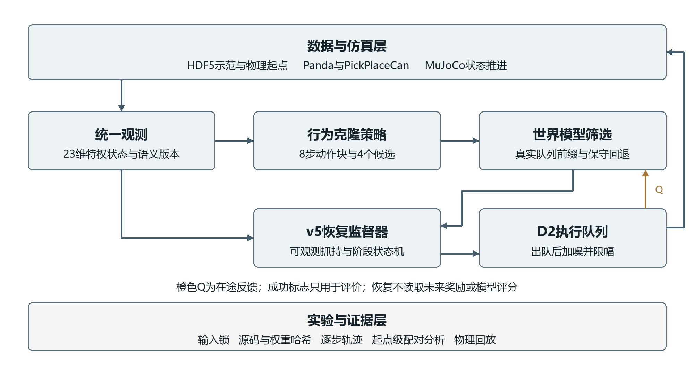
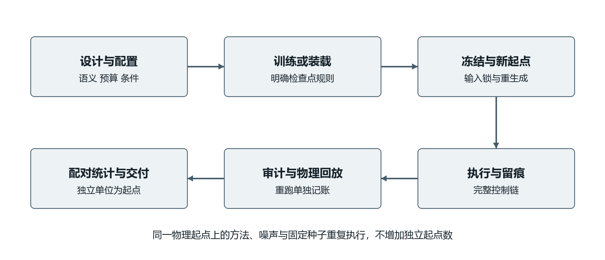
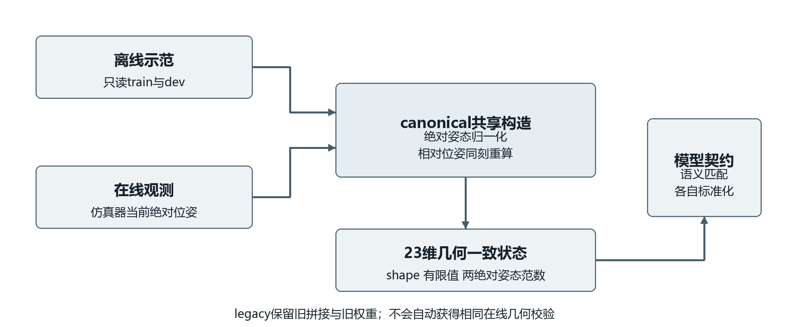
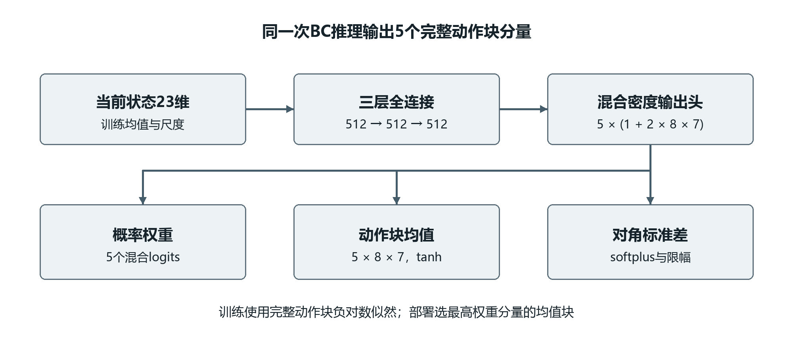
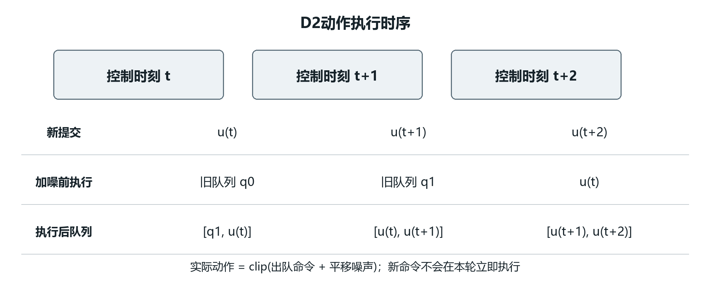
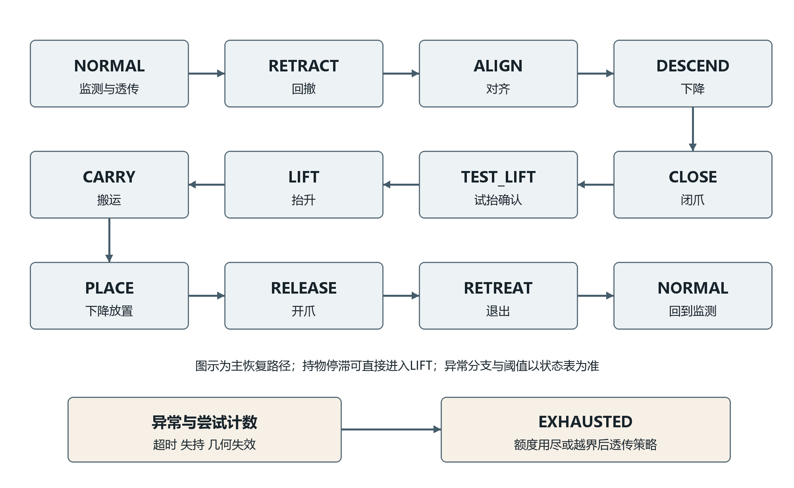
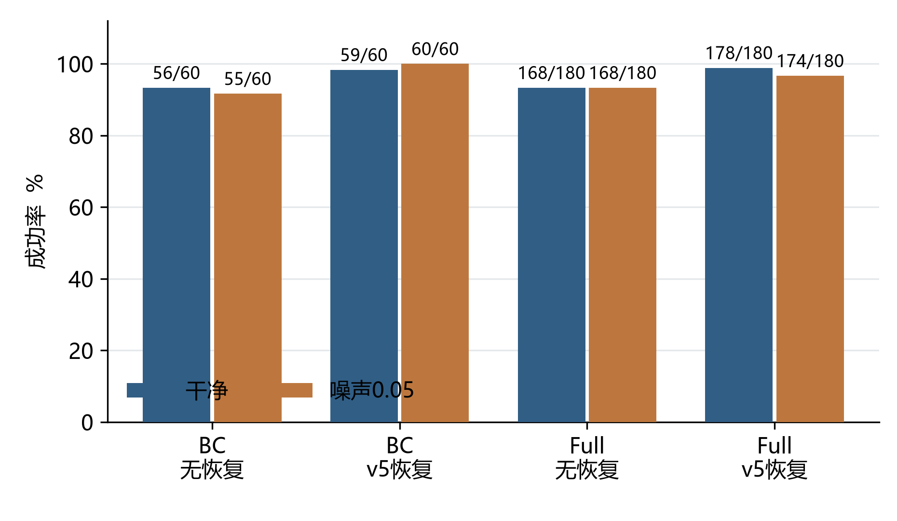
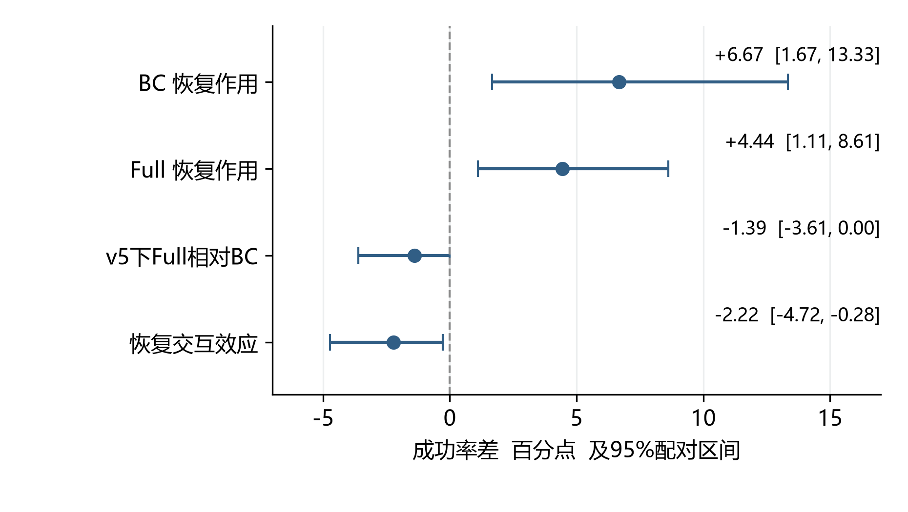
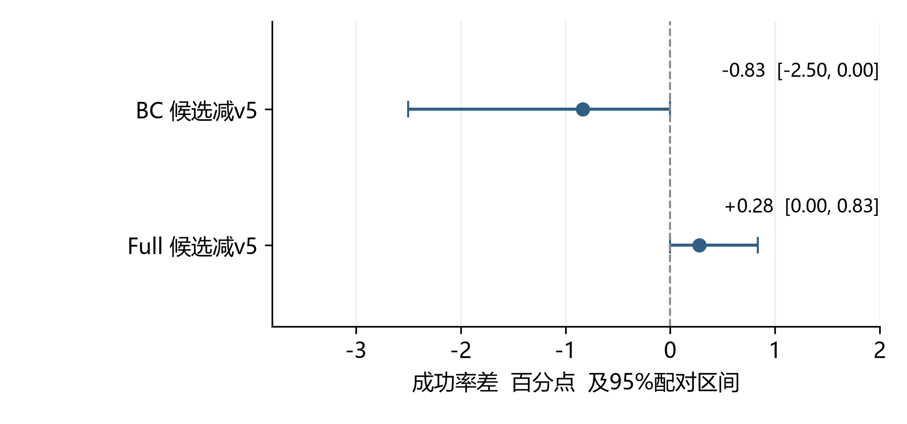

# 机器人抓取搬运与失败恢复系统详细设计

## 摘要

机器人抓取搬运任务要求控制系统在有限时间内完成接近、抓取、抬升、运输与释放。模仿学习策略能够从示范中生成动作，但在动作延迟、执行扰动及偏离示范分布的状态下，仍可能出现重复接近、抓持不稳和搬运停滞。针对上述问题，本设计构建基于低维状态输入的机器人抓取搬运仿真系统，将动作块行为克隆、动作条件世界模型、延迟动作队列和显式失败恢复控制组成可审计的闭环。系统采用统一观测契约，明确区分策略候选评分与恢复状态转换，并以输入锁、源码快照、逐步轨迹及配对统计支撑实验复核。

详细设计围绕需求约束、模块职责、数学模型、接口数据、控制时序、异常处理和验收方法展开。基于固定策略与60个新生成起点的确认实验，行为克隆（Behavior Cloning，BC）在两种扰动条件下的成功执行数由无恢复时的111/120提高至使用v5恢复时的119/120；BC与完整世界模型组合（Full）的对应结果为336/360和352/360。Full的三个固定世界模型种子不增加独立起点数。输入几何修复的匹配重训与队列预算候选均未获得稳定的额外性能收益，因此保留为可复核的工程修复或未采用候选。系统当前使用特权状态和固定任务几何，结论限于已验证的仿真配置。本文档为当前实现的详细设计说明，为后续毕业论文的方法章节、系统实现章节和实验复现提供技术依据。

关键词：机器人抓取搬运；行为克隆；世界模型；动作延迟；失败恢复

## Abstract

Robotic pick and place requires coordinated reaching, grasping, lifting, transport, and release within a finite control budget. Policies learned from demonstrations may stall or lose the object under actuation delay, execution noise, and states outside the demonstration distribution. This design specifies a low dimensional simulation system that combines an action chunk behavior cloning policy, an action conditioned world model, an explicit delay queue, and a failure recovery controller. Shared observation semantics, separate responsibilities for candidate scoring and recovery, immutable experiment inputs, and stepwise execution logs support verification.

The document details requirements, architecture, mathematical models, module interfaces, control timing, failure handling, and acceptance criteria. Confirmation experiments use 60 newly generated physical starts. Across clean and noisy conditions, the frozen BC policy succeeds in 111 of 120 executions without recovery and 119 of 120 with v5 recovery. The corresponding Full results are 336 of 360 and 352 of 360, using three fixed world model seeds. Repeated seeds do not create additional independent starts. Matched retraining with corrected observation geometry and the queue budget candidate do not establish a stable additional performance benefit. Conclusions are restricted to the privileged state simulation setting. This detailed design provides an implementation grounded basis for subsequent thesis chapters and reproducible experiments.

Keywords: robotic manipulation; behavior cloning; world model; actuation delay; failure recovery

# 第1章 绪论与设计范围

## 1.1 问题背景与应用需求

抓取搬运是仓储分拣、零件转运和实验室自动化中的基础任务。一个完整回合包含多个相互依赖的阶段：末端执行器首先移动到物体附近，调整抓取姿态并闭合夹爪，确认物体随夹爪运动，再将物体送入目标区域并完成释放。某一阶段的局部误差会改变后续阶段的初始条件。例如，夹爪在错误姿态下闭合后，即使运输动作与示范一致，也可能发生空抓或物体滑落。因此，评价系统时需要同时考虑策略生成能力和失败后的恢复能力。

行为克隆把示范中的状态与动作对应关系转化为监督学习问题，训练过程明确、部署计算较小，适合作为本科毕业设计的可复现基线。但部署中的状态由策略自身产生，训练中较少出现的偏差状态可能持续累积。数据聚合算法DAgger研究讨论了这一类序列决策分布偏移问题[1]。本系统没有实施在线专家标注或数据聚合，而是在固定离线策略外增加观测驱动的恢复控制，以便隔离并检验恢复机制本身的作用。

在存在执行延迟时，控制器当前输出的动作不会立即作用于环境。若候选评价忽略已提交但尚未执行的动作，就可能把同一观测下的不同真实执行序列当作同一问题。系统据此显式维护在途动作队列，并要求世界模型在评价候选时纳入既定前缀。与之相对应，恢复控制也必须认识到阶段切换后队列中仍可能残留上一阶段动作。

项目的实际意义在于提供一个能够反复运行、定位失败原因并核对控制信息边界的仿真验证平台。其成果可用于研究延迟条件下的策略执行与恢复，不直接证明工业生产收益、真实硬件可靠性或跨物体泛化能力。

## 1.2 技术依据与设计选择

系统基于MuJoCo物理引擎和robosuite机器人仿真框架构建[2,3]，以robomimic研究所使用的离线人类示范学习问题为数据与评价背景[4]。这些基础设施提供机器人、操作任务和数据组织方式，项目自身的工作集中在动作策略、候选评价、失败恢复及实验工程上。平台来源与本项目实现职责在文档中分别说明。

世界模型的基本思想是在动作条件下预测未来状态，为候选动作评价提供中间物理表示[5]。概率集成与轨迹采样方法PETS说明了学习动力学与模型式规划相结合的一种路径[6]，模型预测控制MPC则提供了有限时域反复决策的经典思想[7]。本系统采用小规模低维预测网络和有限候选筛选，没有实施PETS的概率集成与轨迹采样，也没有实现通用连续优化器或Dreamer式潜在空间策略训练。上述文献用于解释设计依据，具体算法以本项目代码为准。

本设计采用可逐项验证的模块组合。行为克隆提供正常动作建议；世界模型对有限候选作比较；共享v5控制器根据可观测状态接管失败恢复；队列预算候选只修改剩余流程估计。这样的责任划分使“世界模型是否有效”和“恢复是否有效”能够分别通过对照实验回答。

## 1.3 设计目标与研究问题

系统的首要目标是在统一输入与执行契约下完成机器人罐体抓取搬运，并在固定控制预算内对停滞、姿态失配和未形成有效抓持等状态执行有界恢复。第二个目标是保存足够的过程证据，使输入语义、候选评分、提交动作、实际动作、状态转换和实验统计能够相互对应。

设计围绕三个可检验问题展开。第一，在相同起点、相同扰动和相同预算下，共享恢复控制对BC及Full各自带来多大作用；第二，把离线与在线相对位姿统一为同刻几何关系后，匹配重训策略的闭环表现如何变化；第三，利用实际在途队列和同阶段进度估计剩余预算，能否比原v5获得额外收益。第三项属于候选假设，其实现完成不等于假设已被实验证实。

## 1.4 实现基线与文档边界

本文档依据Git提交672fa48中的活动实现、2026年10月22日修复报告和确认实验编写。新入口位于robot_can_v2目录；部分成熟组件仍来自common.py、world_model.py及reproduction/recovery_v5_20261012_01。历史文件保持原路径，便于还原原实验。源代码追溯索引见附录B。

设计对象为Panda机器人在PickPlaceCan任务中的低维状态控制。输入包含物体和末端绝对位姿及相对位姿，属于仿真特权信息。相机图像并未进入当前策略和世界模型。系统没有完成真实机器人、视觉感知、多物体联合规划或在线动力学自适应。相关能力列为后续扩展方向，不纳入当前验收结论。

# 第2章 需求分析与约束定义

## 2.1 使用场景与系统边界

系统面向三类操作场景。开发者通过离线训练入口得到动作策略和世界模型；实验人员用冻结作业运行闭环任务并分析配对结果；演示人员读取既有证据和展示页面，说明正常执行、恢复接管及失败案例。三类场景共享模型与数据契约，但实验复验不能被计为新采集的独立样本。

系统边界起于分层数据格式第五版HDF5示范或仿真观测，终止于动作提交、结果文件和分析图表。操作系统、GPU驱动、物理引擎和机器人控制器属于依赖环境。控制器负责生成归一化7维动作，底层OSC_POSE负责将其转换为机器人末端控制目标。本设计不以Python动作幅值直接替代真实末端位移。

## 2.2 功能需求

表2-1 功能需求与验收位置

| 编号 | 功能要求 | 主要实现 | 验收依据 |
|---|---|---|---|
| F01 | 同一契约打包离线和在线23维观测 | observations.py | 几何一致性与非法输入测试 |
| F02 | 训练并加载动作块BC策略 | train_policy.py、common.py | 权重配置和微型训练测试 |
| F03 | 训练状态预测及对照模型 | train_world.py、world_model.py | 方法契约和smoke记录 |
| F04 | 评价含实际延迟前缀的候选动作 | evaluate.py、evaluate_delay.py | FIFO轨迹审计 |
| F05 | 在失败迹象出现时执行有界恢复 | v5控制器、budget.py | 同批有无恢复对照 |
| F06 | 冻结配置并生成完整配对作业 | study.py | 输入锁和作业矩阵校验 |
| F07 | 按物理起点分析统计差异 | analyze.py | 配对CSV和统计公式 |
| F08 | 保存来源、动作、结果与失败尝试 | 各入口及复核脚本 | 哈希、回放和重跑回执 |

每项需求都必须对应实际输出。F03的“支持训练”由新入口和小规模原生训练验收支撑，不能据此声称本轮重新训练了全部正式世界模型。F05的恢复作用由确认实验评价，F08的审计能力则由完整轨迹检查、物理回放和原资产校验分别支撑。

## 2.3 非功能需求

正确性要求优先于效果比较。输入必须具有合法形状、有限数值和可归一化四元数；模型配置必须与输入维度、动作时域和观测语义匹配。部署时拒绝把旧legacy世界模型直接切换到canonical特征，以避免相同23维长度掩盖语义变化。

可复现性要求输入、源码、作业矩阵与输出形成对应关系。新研究运行使用全新目录，训练和分析入口拒绝覆盖已有正式产物。确认前锁定源码、权重和统计方案，生成新起点后再进行顺序与逆序重生成检查。若发生中断，应保留失败尝试，并对重跑的可重合前缀作逐步比较。

性能要求采用与测量范围一致的表述。20Hz控制周期对应50ms，compute_ms用于观察观测打包、策略、世界模型和恢复计算的耗时。物理推进、文件写入、真实传感器和网络不在该计时范围内。因此，50ms阈值是当前软件计算诊断的参考值，不能直接作为真机端到端实时性验收。

可维护性要求新旧实现具有明确入口和可追溯依赖。新模块不通过覆盖历史脚本来替代旧实验；现有权重、失败案例、归档结果及协议继续保留。清理范围限于已确认可再生的缓存，不能按文件名或修改时间删除研究证据。

## 2.4 关键约束与单位

表2-2 正式确认的固定约束

| 项目 | 数值或范围 | 解释 |
|---|---|---|
| 控制频率 | 20Hz | 每个控制周期0.05s |
| 动作维度 | 7 | 平移3、旋转3、夹爪1 |
| 观测维度 | 23 | 特权位姿与夹爪状态 |
| 策略动作块长度 | 8 | 每次输出8个动作建议 |
| 执行延迟 | D=2 | 两个控制周期，名义0.10s |
| 回合上限 | 400步 | 失败时按400步截断 |
| 恢复尝试上限 | 2次 | 与共享v5协议一致 |
| 抓持确认窗口 | 5帧 | 相对位姿稳定性判定 |
| 执行噪声 | 0或0.05 | 加到已出队动作后再限幅 |
| 平移与位置单位 | m | 四元数采用xyzw顺序 |

归一化动作范围为[-1,1]。操作空间位姿控制OSC_POSE的接口思想参见官方文档[8]，本项目具体比例来自锁定的HDF5配置：平移输出上限为每轴0.05m，旋转输出上限为每轴0.5rad，参考系为world，控制模式为增量式。该比例是动作到控制目标的映射，不是物体或末端在接触动力学下必然实现的运动量。D2在50ms周期下对应约100ms名义命令延迟，但不能据此推出真实设备通信时延分布。

# 第3章 总体架构与运行流程

## 3.1 分层结构

系统划分为数据与仿真层、表示与模型层、决策与恢复层、实验与证据层。数据与仿真层提供示范、仿真状态和动作执行；表示与模型层负责统一观测、BC动作块和世界模型；决策与恢复层决定提交动作并维护延迟队列；实验与证据层冻结输入、调度作业、保存轨迹和计算统计结果。



图3-1 系统总体架构与信息边界

在线决策的数据流由观测进入，依次经过特征打包、BC建议、可选世界模型筛选、可选恢复覆盖和先进先出队列FIFO执行。恢复控制可以覆盖策略建议，但世界模型评分不直接触发v5状态转换。环境成功标志只进入评价记录，不反馈到恢复控制器；这条信息边界是判断恢复是否依赖评价“答案”的关键。

离线数据流从训练或开发示范构造状态动作窗口，得到策略与预测模型。训练产物携带配置和来源信息，评估入口据此检查输入契约。分析阶段只读取完成的冻结作业，不重新选择模型、修改控制器或调用仿真器调整结果。

## 3.2 模块责任与依赖关系

表3-1 活动模块职责

| 模块 | 输入 | 输出 | 主要责任 |
|---|---|---|---|
| observations | 原始观测或批量状态 | 23维状态 | 语义、几何与数值校验 |
| train_policy | train/dev示范 | BC权重与配置 | 配对训练与检查点记录 |
| train_world | 候选分支数据 | 世界模型或评分器 | 按方法区分损失和选点 |
| evaluate_delay | 策略、模型、延迟配置 | 评估结果 | 通用延迟候选评价 |
| evaluate | 冻结作业 | 结果和逐步轨迹 | 正式恢复实验闭环 |
| budget | 当前观测、阶段、队列 | 恢复动作与诊断 | v5兼容及预算候选 |
| study | 配置与输入文件 | 冻结作业和阶段回执 | 调度与来源锁定 |
| analyze | 完成阶段 | 汇总JSON和CSV | 起点级配对统计 |

common.py保留环境构建、旧观测打包、策略网络和状态恢复工具；world_model.py保留预测网络与评分函数。v5控制器和几何工具保持原实现，由新入口显式依赖。复用这些组件意味着实现版本必须与实验锁一致，不能只拷贝robot_can_v2目录便声称获得完整可运行系统。

## 3.3 运行阶段及产物

一次研究运行包括准备、训练或装载、冻结、执行、复核和分析六个阶段。准备阶段确定方法、观测语义、起点和扰动；训练或装载阶段产生或指定权重；冻结阶段保存输入锁；执行阶段产生结果与轨迹；复核阶段检查控制链和物理回放；分析阶段生成统计表与图。阶段间的输入具有明确来源，不允许在看到确认成功率之后重新挑选权重或改变作业定义。



图3-2 从设计冻结到结果交付的证据流程

正式确认的单位是物理起点。对同一起点运行多个方法、世界模型种子和噪声条件，可以构造配对差值，却不会得到同等数量的新物理样本。系统在作业层面检查条件完整性，在统计层面先合并固定种子与噪声，再重采样物理起点。

## 3.4 环境初始化与状态恢复

环境构建读取HDF5中的env_args，保留Panda、PickPlaceCan、OSC_POSE及20Hz等任务配置。常规闭环关闭相机输入和离屏渲染，保持物体观测开启。ignore_done设为真，使评估器自行按照首次成功或400步预算终止；该设置不意味着忽略评价成功，而是避免框架终止行为与研究预算发生冲突。

示范状态恢复不能只写入MuJoCo的扁平状态。恢复函数还需要更新机器人复合控制器与各部件控制器的状态、重置目标、清空观测缓存并刷新观测。否则，物理状态已恢复而Python侧控制器目标仍可能属于上一回合，造成同一初始状态下动作不一致。该过程体现了仿真状态与控制器缓存的双重初始化要求。

60个确认起点由预登记的原生初始化种子生成，全部保留，不按策略成功与否过滤。生成后对旧状态作查重，并按相反顺序重建，核对状态完全一致。这样的验证保障起点来源与可重建性，但不构成真实场景分布覆盖证明。

# 第4章 数据与统一观测详细设计

## 4.1 示范数据组织与使用规则

主数据文件为data/can_ph_lowdim_v15.hdf5，共200段示范。data/splits.json把示范分为140段训练、30段开发和30段sealed_test。新训练入口只读取train与dev，sealed_test不参与本轮BC训练及确认权重选择。60个新确认起点是额外生成的状态集合，不应与30段封存示范混称为同一个测试集。

HDF5即分层数据格式第五版，其示范数据的一般组织方式参见官方文档[9]。本项目实际每段示范包含obs、next_obs、actions、rewards、states和模型XML等内容。策略训练读取观测和动作；状态恢复读取物理状态与模型描述；奖励或任务标签的使用必须遵循相应离线分支构造协议。在线恢复不查询示范奖励，也不以环境成功标志作为控制输入。

动作窗口按示范内部顺序构造。若某段示范具有T个动作、动作块长度为H，则窗口起点为0至T-H，窗口数为max(T-H+1,0)。窗口不会跨越两段示范边界。当前匹配BC训练产生15,373个训练窗口和3,198个开发窗口；这些窗口来自同一段轨迹的重叠片段，不能当作同等数量的独立示范。

## 4.2 23维状态向量

系统采用末端世界位姿、夹爪关节位置、物体相对末端位姿和物体世界位姿组成的23维状态。表4-1使用Python左闭右开切片表示索引。

表4-1 状态字段与几何含义

| 索引 | 维度 | 符号 | 含义 |
|---|---|---|---|
| 0:3 | 3 | p_e | 末端在世界坐标系的位置 |
| 3:7 | 4 | q_e | 末端世界姿态，xyzw |
| 7:9 | 2 | g | 两个夹爪关节位置 |
| 9:12 | 3 | p_rel | 物体在末端坐标系的位置 |
| 12:16 | 4 | q_rel | 物体相对末端的姿态 |
| 16:19 | 3 | p_o | 物体在世界坐标系的位置 |
| 19:23 | 4 | q_o | 物体世界姿态，xyzw |

绝对与相对位姿同时存在，便于策略使用空间关系，但也引入一致性要求。若绝对位姿来自时刻t、相对位姿来自上一轮缓存，则这23个数不能共同描述同一个刚体场景。此前发现的问题正发生在相对传感器依赖与缓存更新时序上，因此本轮修复将相对特征重算逻辑集中到同一模块。

## 4.3 同刻位姿变换与四元数规范

记末端与物体的世界变换分别为T_e和T_o，则物体相对末端变换满足：

$$
T_{rel}=T_e^{-1}T_o
$$

由此得到相对位置与相对姿态：

$$
p_{rel}=R(q_e)^{T}(p_o-p_e),\qquad q_{rel}=q_e^{-1}\otimes q_o
$$

其中R(q_e)为末端四元数对应的旋转矩阵，⊗表示四元数乘法。相对位置是在末端坐标系中的向量，不能简单用世界坐标差代替。四元数先归一化，四个分量的顺序固定为x、y、z、w。由于q和−q表示同一空间旋转，相对四元数采用确定符号规范，减少等价姿态在数值表示上的跳变。

canonical分支从当前绝对位姿重新计算相对字段，并供离线与在线共同调用；legacy分支保持旧数据语义，用于加载历史权重和匹配对照。canonical不会修正历史文件中的原始字节，也不会使旧权重自动适应新的输入分布。输入语义是模型契约的一部分，应随检查点保存并在部署前核对。



图4-1 离线与在线共用的观测构造及校验流程

## 4.4 标准化与非法输入处理

模型使用各自训练数据估计的均值μ和尺度s对输入标准化，世界模型预测输出再映射回原物理量。BC与世界模型分别保存统计量，并非共用一组均值和尺度：

$$
z=(x-\mu)/s,\qquad \hat{x}=\hat{z}\odot s+\mu
$$

均值和尺度作为网络buffer随权重存储，部署时不能使用当前确认批次重新拟合。这样可以避免把确认分布信息引入训练预处理。canonical在标准化前检查末维23、实数与有限值，并要求两个绝对姿态四元数范数不小于1e-12；原相对四元数允许为零，因为其内容会被重建。legacy保留历史在线拼接路径，没有施加同样的在线范数与几何检查；离线读取会核对维度和有限性。统一所有兼容入口的强校验仍属于后续工程完善项。

非法输入应明确报错并保留原因，而非静默用零向量替换或继续执行。新入口对观测语义、模型配置和输出目录的失败处理采取显式异常；异常意味着该次作业尚未完成验收，不能只依据部分成功回合生成最终结果。

## 4.5 训练语义修复的公平比较

两种语义采用同一网络、初始化、批次索引与15,000次更新，初始化及批次哈希一致。性能比较使用确认前指定的final.pt；两臂开发负对数似然最优均在1,000次更新。选择规则和过拟合局限见第5章，几何修复不预设闭环收益。

# 第5章 行为克隆策略详细设计

## 5.1 设计目标与模块职责

行为克隆策略承担由当前机器人与物体状态生成动作建议的任务。输入包括末端执行器位姿、夹爪关节位置和物体位姿，末端执行器英文缩写为EEF；输出为有限时域的连续动作块。系统以专家演示为监督信号，通过离线训练学习状态到动作的映射，再在仿真控制过程中逐帧调用。与只预测单个动作相比，动作块同时给出近期多个时间位置的动作建议，为延迟补偿和后续候选筛选提供统一接口。它不在策略内部执行物理仿真，也不直接负责失持检测或恢复阶段切换。

本项目正式策略采用多层感知机MLP与混合密度网络MDN输出头。混合分布用于表达演示中同类状态可能对应多种合理动作的情况，避免以单一均方误差回归将多个动作模式直接平均[10]。部署时采用确定性分量选择，因此同一状态和同一检查点得到相同动作块。该策略是低维特权状态条件策略；相机图像、目标检测和视觉编码不属于本模块的已实现范围。

## 5.2 输入组织与训练窗口构造

记控制时刻为 \(t\)，状态为 \(x_t\in\mathbb R^{23}\)。该状态依次包含末端执行器世界位置3维、世界四元数4维、夹爪关节2维、物体在末端坐标系中的相对位置3维和相对四元数4维、物体世界位置3维与世界四元数4维。四元数使用 \(xyzw\) 顺序。状态既包含绝对量也包含相对量，属于显式冗余表示；相对量有助于描述抓取几何，但两类量必须来自同一观测时刻。

新数据接口提供 legacy 和 canonical 两种版本。legacy 保留历史传感器拼接结果，以兼容既有模型；canonical 从同一帧绝对位姿重算相对量，并归一化姿态四元数。两种输入在数值维度上相同，在传感器语义上不同，因此检查点必须记录版本，运行时不能只根据维数相同就相互替代。所有状态须为有限实数，训练读取器只允许训练集与开发集，并将读取后的数组标为只读。

设一条演示有 \(T\) 个动作，动作块长度为 \(H\)。从该演示构造如下监督样本：

$$
\mathcal D_{BC}^{(e)}=
\left\{\left(x_t,A_t\right)\mid 0\leq t\leq T-H\right\},
\qquad
A_t=[a_t,a_{t+1},\ldots,a_{t+H-1}]\in\mathbb R^{H\times7}.
$$

其中 \(e\) 表示父演示，\(A_t\) 是专家未来动作块。每条轨迹独立取窗，不跨轨迹拼接；长度小于 \(H\) 的演示不贡献窗口。项目采用 \(H=8\)，训练集140条演示形成15,373个有效窗口，开发集30条演示形成3,198个窗口。窗口有时间重叠，不能将窗口数量解释为相互独立的任务起点数量。数据集划分以父演示为单位完成，随后才生成窗口。

输入标准化只使用训练窗口起点状态统计量：

$$
\tilde x_{td}=\frac{x_{td}-\mu_d}{s_d},
\qquad s_d=\max\{\operatorname{Std}_{train}(x_d),0.02\}.
$$

\(d\) 为状态维度，\(\mu_d\) 和 \(s_d\) 随检查点保存。标准差下界限制近常量维度的放大倍数；开发和在线输入复用训练统计量，不能重新计算各自标准差，否则会改变模型输入契约。

## 5.3 混合密度动作块网络

网络由三个宽度为512的全连接隐层构成，每层使用修正线性单元ReLU激活。输出头同时生成 \(K=5\) 个高斯分量的混合权重、动作均值与标准差。所有分量覆盖同一个完整 \(H\times7\) 动作块，而不是为每个时间步独立选择一个分量。网络接口如下。

表5-1 动作块网络张量约定

| 张量 | 批量形状 | 含义 |
|---|---|---|
| 状态输入 | \(B\times23\) | 标准化前的当前状态 |
| 共享特征 | \(B\times512\) | 三层MLP输出 |
| 混合logits | \(B\times K\) | 经过softmax得到分量权重 |
| 均值与标准差 | 各 \(B\times K\times H\times7\) | 完整动作块分布参数 |
| 确定性动作块 | \(B\times H\times7\) | 最高权重分量的均值 |

设输出头的原始数值为 \(l_k,v_{khd},w_{khd}\)，则分布参数为：

$$
\pi_k=\operatorname{softmax}(l)_k,\quad
m_{khd}=\tanh(v_{khd}),\quad
\sigma_{khd}=\operatorname{clip}\!\left(\operatorname{softplus}(w_{khd}),0.02,1\right).
$$

\(h\) 表示动作块中的时间索引，\(d\) 表示动作维度。tanh 约束均值位于归一化动作范围，标准差截断避免过窄分布造成数值不稳定。输出头长度为 \(K(1+2H\cdot7)=565\)，网络共有827,445个可训练参数，不包含标准化缓冲区。仓库另含循环策略类，但本次正式策略的架构标记为MLP，推理过程不使用循环网络或历史帧队列；旧配置中的history字段不改变该事实。



图5-1 混合密度动作块策略结构

## 5.4 训练目标与参数更新

在给定状态的条件下，动作块概率密度采用对角高斯混合：

$$
p_\theta(A\mid x)=
\sum_{k=1}^{K}\pi_k(x)
\prod_{h=0}^{H-1}\prod_{d=1}^{7}
\mathcal N\!\left(A_{hd};m_{khd}(x),\sigma_{khd}^{2}(x)\right).
$$

训练最小化按动作元素数归一化的负对数似然：

$$
\mathcal L_{BC}=-\frac{1}{BH7}
\sum_{b=1}^{B}\log p_\theta(A^{(b)}\mid x^{(b)}).
$$

实现使用logsumexp计算混合似然，以避免直接求多个高维概率密度乘积时下溢。开发集动作均方误差作为辅助诊断，仅比较确定性策略输出的第一条动作和专家第一条动作；检查点优选指标仍是完整动作块负对数似然。连续概率密度可能大于1，因此负对数似然可以为负，不能套用离散分类交叉熵的非负解释。

表5-2 BC配对训练参数

| 参数 | 本轮配对训练配置 |
|---|---:|
| 随机种子 | 17 |
| 动作块长度／混合数 | 8／5 |
| 隐层宽度 | 512 |
| 批量／更新次数 | 256／15,000 |
| 优化器／学习率 | Adam／0.0003 |
| 梯度范数裁剪阈值 | 10 |
| 完整开发集验证间隔 | 1,000次更新 |

为比较观测语义，legacy 与 canonical 两臂使用相同网络、初始可训练参数与窗口索引序列。批次采样通过独立CPU随机数生成器完成，使数据抽样不依赖网络初始化消耗的随机数，也不因设备改变而隐式改变采样顺序。两臂分别计算训练状态标准化统计量，这是输入语义变化的必要组成部分，不能要求其缓冲区数值相同。初始化与批次序列均保存SHA-256摘要，便于复查配对条件。

每次训练输出开发集最优的best权重与最后一步final权重。当前语义确认实验预先固定使用15,000步的final权重，没有根据闭环成功率重新选择。两臂开发集最优值均出现在1,000步，说明最终训练过程存在过拟合迹象；因此本文将固定末步和验证集最优明确区分。后续若研究早停，应重新建立独立协议，不能在看到当前确认结果后替换权重并沿用原统计结论。

## 5.5 在线推理与下游接口

部署时选择混合权重最大的分量，并返回该分量的整个均值动作块：

$$
k_t=\arg\max_k l_k(x_t),\qquad
\bar A_t=m_{k_t}(x_t)\in[-1,1]^{8\times7}.
$$

这是一种确定性分量选择，不是从混合分布随机采样，也不保证找到混合密度的全局众数。七维动作依次为三个位置控制量、三个姿态控制量和一个夹爪控制量；它们进入仿真控制器后才按控制器尺度映射为实际增量。正式环境以20Hz运行，平移输出尺度上限0.05，姿态上限0.5，因此不能将网络原始输出直接解释为米每秒。

下游接口只读取动作建议，不反向更新策略权重。无世界模型时，延迟补偿基线选取动作块索引2；有世界模型时，前4条动作形成候选，再进行评分与保守回退；恢复监督器还能按当前阶段改写所选动作。由此，BC输出、候选proposal、实际submitted命令和FIFO出队后的executed命令是四个不同对象，必须在运行日志中分开记录。策略模块不能宣称独立实现了恢复成功，其作用需要通过关闭和启用恢复的配对实验辨别。

# 第6章 动作条件世界模型与候选筛选详细设计

## 6.1 模块定位与状态预测结构

世界模型用于预测同一当前状态下不同动作命令可能造成的短期物理状态变化，并为候选动作提供进展与失持评价。模型以低维显式状态和动作序列为输入，输出未来8步的23维状态及两类标签读出。它不生成图像，不进行在线权重更新，也没有引入大型潜空间生成架构。运行时只在有限候选中选择命令，并在下一控制周期重新观测与决策，不能将其描述为未经实现的连续轨迹优化器。

递推采用门控循环单元（Gated Recurrent Unit，GRU）。设预测步索引为 \(j\)，标准化状态为 \(z_j\in\mathbb R^{23}\)，隐藏状态为 \(h_j\in\mathbb R^{128}\)，已知动作序列为 \(U\in\mathbb R^{H\times7}\)。初始编码与递推为：

$$
z_0=(x_t-\mu)/s,\qquad h_0=\tanh(W_i z_0+b_i),
$$
$$
h_{j+1}=\operatorname{GRUCell}([z_j,u_j],h_j),\qquad
z_{j+1}=z_j+0.1f_\Delta(h_{j+1}),\qquad
\hat x_{t+j+1}=s\odot z_{j+1}+\mu.
$$

其中 \([\cdot,\cdot]\) 表示特征拼接，\(f_\Delta\) 为带ReLU的两层MLP，\(\odot\) 表示逐元素乘法。0.1是状态残差更新的固定缩放系数，不应解释为环境控制时间步长。GRU输入为30维，隐藏维数128，残差头为128→128→23。预测完全使用上一预测状态继续递推，不在中间插入未来真实状态。

表6-1 模型分支职责与损失

| 子模块 | 结构 | 正式Full设置 |
|---|---|---|
| 初始隐藏状态 | 23→128，Tanh | 启用 |
| 动作条件递推 | GRUCell，输入30、隐藏128 | 启用 |
| 状态残差头 | 128→128→23，ReLU | 启用 |
| 标签读出 | 23→128→2，ReLU | future_only |
| 总可训练参数 | 含偏置、不含标准化缓冲区 | 87,321 |

future_only规定标签头只读取预测物理状态 \(z_{j+1}\)，避免读出直接依赖隐藏特征而绕开显式预测接口；GRU隐藏状态仍参与物理状态递推。兼容分支也可读取 \([z,h]\)，但它不用于本次正式Full。模型没有对预测四元数施加硬约束，也没有对冗余相对量重新投影，所以预测状态不保证严格满足刚体几何一致性。该限制应与输入端canonical语义修复分开理解。

## 6.2 同起点反事实分支数据

世界模型训练需要观察相同起点下不同动作导致的差异。正式冻结Full使用真实pending队列分支数据：训练由20个父轨迹各取8个点形成160组，开发由8个父轨迹形成64组，每组包含4个候选和8步未来。一个候选组共32个分支步，但这些分支共享起点，不能当作32次独立任务试验。

采集首先从演示起点运行D2延迟条件下的BC-shift策略，保存每个控制周期的状态、实际执行动作历史、待执行队列和控制器签名。选取锚点后，以该点BC动作块前4条命令作为候选。每次候选展开都重新恢复演示初态，重放锚点之前的完整已执行动作历史，再恢复相同pending队列。这样可同时重建物理状态及控制器内部状态，减少仅恢复MuJoCo状态向量而遗漏控制器缓存的问题。

采集器还验证重放观测、物理与控制器签名及阶段奖励，允许误差上限为 \(10^{-7}\)；检查各候选前D步公共状态一致，并反向遍历候选检查结果不依赖采集顺序。数据中的动作记录是实际从FIFO出队执行的序列，而不是尚未生效的新命令。real数据保留真实队列；另有zero配对数据将同一锚点队列置零，仅用于既有队列覆盖诊断。当前正式模型来自real分支，不能将两者笼统混称为随机扰动演示数据。

监督标签包括进展 \(p_j^*\) 与失持 \(r_j^*\)。若环境判定成功，进展记为1，否则取分阶段奖励最大值；它是软标签，不是未来成功事件的二分类概率。分支初始抓取标记定义为锚点抓取阶段奖励大于0.3，区别于v5的五帧可观测抓持判据。初始标记为真、当前抓取阶段奖励低于0.3且未成功时，失持标签记1，其他情况为0。因此风险读出刻画特定失持现象，尚不覆盖所有碰撞、越界或人员安全风险。标签依赖采集阶段仿真反馈，在线候选排序由已训练网络完成，不展开未来环境获取真实奖励。

## 6.3 联合学习目标与消融分支

标签头输出两个logits，经sigmoid得到预测进展 \(\hat p_j\) 和失持读出 \(\hat r_j\)。候选分数定义为：

$$
S=\hat p_H+\frac{0.5}{H}\sum_{j=1}^{H}\hat p_j-\rho\max_{1\leq j\leq H}\hat r_j,
\qquad \rho=0.5.
$$

第一项关注末步预测进展，第二项兼顾整个预测时域，第三项惩罚峰值失持读出。真值分数 \(S^*\) 采用同样公式，由真实软标签替代预测值。该分数为无量纲启发式排序量，理论范围为[-0.5,1.5]，不是物理距离或经校准成功概率。

状态预测损失、标签损失与排序损失共同构成Full目标：

$$
\mathcal L_{pred}=\operatorname{Mean}_{b,k,j,d}
\left[\left(\frac{\hat x_{bkjd}-x^*_{bkjd}}{s_d}\right)^2\right].
$$
$$
\mathcal L_p=\operatorname{BCEWithLogits}(\ell_p,p^*).
$$
$$
\mathcal L_r=\operatorname{BCEWithLogits}(\ell_r,r^*).
$$

\(b,k,j,d\) 分别表示候选组、候选、未来步和状态维度，\(s_d\) 来自训练起点状态，最小为0.02。候选排序只比较同组中真实分数差超过0.025的上三角配对，以免近等价候选主导目标。设这些信息对为集合 \(\mathcal M\)，则：

$$
\mathcal L_{rank}=\operatorname{Mean}_{(i,j)\in\mathcal M}
\operatorname{softplus}\!\left[
-\frac{\operatorname{sign}(S_i^*-S_j^*)(S_i-S_j)}{0.1}
\right],
$$
$$
\mathcal L_{Full}=\mathcal L_{pred}+\mathcal L_p+0.5\mathcal L_r+0.2\mathcal L_{rank}.
$$

分母0.1为排序温度，集合为空时排序损失返回可求导的零。一个训练批次抽16组并保留每组全部4个候选，实际展开64个序列。正式训练使用Adam、学习率0.0003、3,000次更新、梯度裁剪10，每250步进行完整开发集评价；Full按最小开发集平均选择后悔值选权重，指标相同保留较早步骤。

消融方法由统一接口定义。Plain保留状态与标签学习，但取消排序损失；prediction_only仅训练状态预测，标签参数冻结，新入口完全绕过该标签头，按开发集状态均方误差选择权重；DirectScore不预测物理状态，将标准化当前状态与展开后的动作块拼接，经MLP直接输出各步标签。历史参数匹配实验给DirectScore设置251宽度，参数87,364，接近Full；新通用训练入口默认128宽度，二者不应混用。

本次正式确认沿用历史冻结的Full种子17、23、41检查点，其数据与训练协议可追溯；新增train_world入口完成了契约校验与各分支短训练冒烟验证，尚不能据此宣称整套正式世界模型已经重新训练。完整四分支消融与当前恢复因子实验属于不同实验层级，后者只使用BC和冻结Full，不将新入口短训练结果纳入正式性能结论。

## 6.4 包含真实队列的候选展开

设当前pending队列为 \(Q_t=[q_t^0,\ldots,q_t^{D-1}]\)，新提交命令为 \(c\)。当D=2时，当前物理执行最旧的 \(q_t^0\)，新命令需经过两个控制周期才生效。模型输入必须包含已不可撤销的公共队列前缀：

$$
U_t(c)=\left[q_t^0,\ldots,q_t^{D-1},c,c,\ldots,c\right]_{H\ \mathrm{steps}},\qquad H>D.
$$

正式方案固定H=8、D=2，从BC块取 \(c_k=\bar A_t[k]\)，\(k\in\{0,1,2,3\}\)。每个候选仅代表本次提交的一条命令；后续重复是用于比较的有限时域假设，不表示将整段预测动作开环执行。四条序列共享前两条pending动作，新命令首次影响模型未来状态的零基索引2。忽略前缀会把尚未生效的候选误判为已经改变环境，造成训练与执行条件不一致。

系统用预测标签计算四个分数，先取得分最大索引，再以索引2作为保守回退：

$$
k^{raw}=\arg\max_{k\in\{0,1,2,3\}}S_k,\qquad
k^{sel}=\begin{cases}
2,&k^{raw}\neq2\ \land\ S_{k^{raw}}-S_2<0.02,\\
k^{raw},&\text{其他情况}.
\end{cases}
$$

门限0.02限制模型在优势较小时改写BC-shift建议。等于门限时允许切换，分数并列时argmax选择首个最大值索引。没有世界模型的基线直接选索引2，从而保持候选基准一致。输出命令随后交由恢复监督器决定是否覆盖，再进入实际FIFO，最后加入预注册的执行扰动并执行。noise=0.05表示归一化平移动作的高斯标准差，不是观测噪声，也不能写成5厘米物理位移。

```text
算法：单控制周期的冻结策略候选建议
输入：当前状态x，实际pending队列Q，BC策略π，可选Full模型F
1. 检查输入语义、维数、H=8和D=2的一致性
2. A ← π.best(x)                         # A的形状为8×7
3. 若F不存在：返回A[2]及索引2
4. 对k=0,1,2,3：
       U[k] ← concat(Q, repeat(A[k], H-D))
5. (未来状态, 标签logits) ← F(repeat(x,4), U)
6. 对每个k按末步进展、平均进展与峰值失持计算S[k]
7. raw ← argmax(S)
8. selected ← raw
9. 若raw≠2且S[raw]-S[2]<0.02：selected ← 2
10. 返回A[selected]、selected、S
后续：恢复监督器审查proposal；submitted入队；最旧动作出队并执行
```

## 6.5 通用评估接口与设计边界

独立的无恢复延迟评估入口还支持随机扰动候选、物理代价与学习分数混合。这是扩展诊断接口，不是上述正式四候选配置。物理代价在排除公共D步前缀后计算：未持物时取预测EEF与物体平均距离；持物时取物体到目标平均距离，加最终物体高度低于0.86时的惩罚。持物hint来自当前物体高度大于0.88且EEF物体距离小于0.10的启发式判定。混合目标为 \(J=C_{physical}-wS\)，默认 \(w=0.02\)，选择最小目标；纯状态预测分支固定 \(w=0\)，禁止调用未训练标签头，DirectScore则只允许学习分数模式。

为保证设计与检查点一致，入口检查模型方法、状态维数、预测时域和观测语义；canonical分支数据必须显式声明并通过同帧几何检查。训练与开发数据有parent元数据时，进一步检查父轨迹互斥且属于各自原始划分。现有正式数据具备该字段；若外部NPZ省略parent，新入口无法仅靠文件名证明无泄漏，工程规范应要求新数据必填parent。所有训练与评估使用新输出目录，保存源码、数据与权重摘要，避免覆盖历史证据。

排序评价应同时报告后悔值、有效信息对数、严格逆序率与并列率。旧指标只把严格反向计错，会遗漏全并列等退化情况；新指标将预测分差绝对值不超过 \(10^{-8}\) 的情况单列，并提供并列计半错的错误率。正式分支数据的有效排序对较稀疏，训练仅96/960、开发39/384，故离线排序表现不能替代闭环任务验证。当前实验也未证实世界模型在所有恢复配置下优于BC，详细设计应将其界定为可复查的候选评价模块，而将系统性能归因留给控制变量实验。

# 第7章 延迟执行与失败恢复详细设计

## 7.1 设计目标与观测边界

机器人抓取搬运任务并不总能按照行为克隆策略生成的轨迹完成。当目标罐体靠近容器边缘、初始姿态发生改变，或者控制执行受到延迟和扰动影响时，策略可能出现反复接近而未抓住物体、抓持后丢失物体或搬运过程停滞等现象。本系统在学习策略之后设置独立的恢复监督器，对可观测的执行进展进行检查，并在满足明确条件时覆盖策略动作，执行有界的重抓取与放置流程。

恢复监督器采用23维低维状态，包括末端执行器世界位姿、两夹爪关节位置、物体相对位姿及物体世界位姿，并接收固定目标位置和容器底面高度。物体位姿由仿真环境直接提供，属于特权观测；当前方案尚不包含从相机图像估计罐体位姿的感知链路。监督器运行过程中不接收奖励、环境成功标志、接触力或未来真实状态，也不直接读取世界模型评分。世界模型仅在上游筛选策略候选动作，恢复器依据状态历史独立决定是否干预，两者可以分别启用，以支持后续对照实验。

这一边界使恢复逻辑具有清晰的输入输出接口，也限定了结论的适用范围：本文讨论已知场景中的仿真失败恢复，不将固定几何模型下的余量检查等同于真实机械臂的安全保证。

## 7.2 延迟执行链路与动作接口

控制频率为20 Hz，一个控制周期为0.05 s。动作向量为7维，前三维对应世界坐标系平移增量，随后三维对应姿态增量，最后一维控制夹爪。动作归一化范围为[-1,1]；OSC控制器平移输出比例为0.05 m，旋转输出比例为0.5 rad。这些比例描述控制目标增量，实际末端运动还受到机械臂动力学和控制器响应影响。

为模拟执行延迟，系统维护容量为2的先进先出命令队列。记当前观测为$x_t$，监督器本轮生成的新命令为$u_t$，待执行队列为$Q_t=[q_t^{(0)},q_t^{(1)}]$，则无扰动时有：

$$
a_t=q_t^{(0)},\qquad Q_{t+1}=[q_t^{(1)},u_t].
$$

因此，当前生成的$u_t$在两个控制周期之后执行，名义延迟为0.1 s。回合开始时队列中的两个命令均为全零向量。每回合最多执行400次控制，即名义20 s仿真控制时间；400不是物理引擎内部积分步数，20 s也不是程序墙钟运行时间。

学习策略输出长度为8的动作块$B_t$。BC基线固定选择索引2；Full方法对前四个索引进行筛选。每个候选的世界模型输入由当前队列的两条真实待执行命令与候选命令重复六次组成，总长度仍为8。筛选后得到的proposal再交给恢复器，恢复器在NORMAL或EXHAUSTED状态透传它，在恢复阶段返回对应的位姿控制动作。每轮执行顺序如下：

```text
输入：上一控制周期返回的观测 obs，FIFO 队列 Q，上一实际动作 a_prev
1. 按已声明语义打包当前状态 x
2. 行为克隆策略生成动作块 B
3. 根据 B、x 和当前 Q 得到 BC 或世界模型筛选后的 proposal
4. 向预算候选传入 Q 的副本，监督器返回新命令 u 和诊断信息
5. 记录状态、动作块、Q、proposal、新命令及恢复事件
6. 将 u 加入 Q 尾部，从 Q 头部取出本轮实际执行命令 a
7. 给 a 的平移通道加噪，再限幅到 [-1, 1]，更新 a_prev
8. 执行环境控制，记录下一状态并查询基准成功判据
9. 首次成功时终止基准，否则继续至 400 次执行
```

扰动施加于出队命令的前三维，采用独立零均值高斯噪声；噪声标准差以归一化动作单位表示。恢复器接收的previous_action是上一次含噪并限幅后的实际动作，而不是上一轮新提交动作。这一约定使夹爪闭合判据与真实执行链路保持一致。逐步轨迹同时保存加噪前后动作，避免把策略选择、监督器覆盖、队列延迟和执行扰动混为同一误差来源。



图7-1 提交动作与实际执行动作的时序

## 7.3 抓持状态与停滞检测

### 7.3.1 可观测抓持判据

令末端与物体世界位置分别为$p_e$和$p_o$，夹爪开口为$g=|x_7-x_8|$，世界系位置差为$r=p_e-p_o$。这里的$r$区别于第4章在末端坐标系中表达的$p_{rel}$。系统仅在以下条件同时成立时认定本帧存在可观测抓持：夹口处于0.025～0.067 m的开区间；末端物体距离小于0.09 m；包含当前帧的最近五帧相对位置均与当前$r$相差小于0.012 m；物体相对参考高度抬升超过0.02 m；上次实际执行的夹爪命令为闭合，或者抓持状态已锁存。

通常参考高度取回合初始物体高度；TEST_LIFT阶段取进入CLOSE时记录的物体高度，从而检查当前重抓取是否带动物体上升。五帧要求表示相对位置历史的一致性窗口，并非连续五次布尔抓持判定为真。抓持一经确认，stable与ever_stable被锁存；后续不再满足抓持条件时累积lost_frames，达到五帧且不属于主动释放时才报告抓持丢失。

主动释放包括RELEASE、RETREAT，以及NORMAL中物体已经到达目标平面区域、曾确认抓持且策略开始开爪时建立的25步抑制窗口。该机制减少正常投放被误判为抓取失败。内部目标区域只检查物体与目标在XY方向的误差分别小于0.0875 m和0.1125 m，不等同于环境的完整成功判据。

### 7.3.2 恢复触发顺序

监督器每步更新全局clock、当前阶段age和最多41帧的状态历史。NORMAL状态按以下优先级检查：首先处理已确认的抓持丢失；其次检查带时间压力的早期停滞；再次检查长时间无进展或预算保护时刻；最后检查近物体停滞或持物停滞。使用有序条件可以避免同一帧重复启动多个恢复流程。

早期停滞要求正常执行至少80步、末端物体距离大于0.12 m、最近25帧距离改善不足0.008 m且物体抬升不足0.02 m，同时满足时间压力、物体可恢复和未进入目标区域等条件。长停滞以末端物体距离的历史最优值为依据，改善超过0.008 m才刷新进展时刻；连续65步未刷新，或者到达第160步预算保护时刻，可启动恢复。近物体及持物停滞使用40步窗口，要求最大有效进展不足0.005 m；未抓持时检查接近物体和物体升高，持物时检查物体升高及接近目标的进展。

上述触发均排除主动释放，并检查物体位于恢复工作空间：$-0.24<x_o<0.45$、$-0.57<y_o<0.57$、$z_o>z_{floor}-0.04$。每回合最多启动两次恢复尝试，次数不会在返回NORMAL时重置。恢复过程中物体离开该范围，或者尝试额度用尽，进入EXHAUSTED并透传策略动作。EXHAUSTED不是安全急停，也不自动输出零动作。

## 7.4 分阶段恢复状态机

恢复过程由明确的状态、阶段目标、最小驻留时间和退出条件组成。记$D=2$，底面高度为$z_f$，抓取目标为$p_g$，抓稳后记录的末端相对物体偏移为$b$。

表7-1 恢复状态与正常转换

| 状态 | 主要动作及正常转换条件 |
|---|---|
| NORMAL | 透传策略动作并监测失败；一般进入RETRACT，持物停滞可直接进入LIFT |
| RETRACT | 保持当前姿态回撤至$\max(z_f+0.20,z_e)$；age>$D+5$且高度距目标不超过0.012 m时进入ALIGN |
| ALIGN | 移至抓取点上方，高度为$\max(z_f+0.20,z_o+0.14)$；age>$D+5$、位置误差<0.014 m且姿态误差<0.15 rad时进入DESCEND |
| DESCEND | 接近$p_g$；age>$D+5$且位置误差<0.009 m时进入CLOSE |
| CLOSE | 维持抓取位姿并闭爪；age≥$16+D$时进入TEST_LIFT |
| TEST_LIFT | 闭爪并抬高0.06 m；age≥$D+5$且抓持确认时进入LIFT，否则到35步仍未确认则重试 |
| LIFT | 搬至物体高度$z_f+0.28$并补偿$b$；物体高度达到目标下方0.016 m以内且仍抓持时进入CARRY |
| CARRY | 闭爪搬至目标XY上方；age>$D+5$且物体XY误差<0.045 m时进入PLACE |
| PLACE | 下降至物体目标高度$z_f+0.085$；age>$D+5$、XY误差<0.05 m且物体高度<$z_f+0.10$时进入RELEASE |
| RELEASE | 保持进入阶段时的末端位置并开爪；age≥$14+D$时进入RETREAT |
| RETREAT | 开爪向上退出0.12 m；age>$D+5$且末端误差<0.02 m时清理抓持历史并返回NORMAL |
| EXHAUSTED | 停止恢复干预，透传学习策略proposal |

在RETRACT、ALIGN、DESCEND阶段，若规划指定了预抓取开口，则夹爪通道按开口误差生成小幅调节命令，不能将这些阶段统一理解为始终发送最大开爪动作。阶段转换在本步动作计算后发生，因此日志的mode表示本步动作所属阶段，next_mode表示状态更新结果。

普通阶段超时为70步；CARRY超过110步触发运输超时。ALIGN对仍有进展且物体保持静置的直立抓取可延长至110步；当其位置与角度组合误差持续18步无显著改善、物体静置、尚未切换方向且仍有额度时，尝试绕世界Z轴旋转π的等价抓取方向。DESCEND在age≥25、连续18步无超过0.003 m的距离改善、误差仍≥0.012 m且时间有压力时，也可提前重试。LIFT、CARRY或PLACE中发生抓持丢失，物体已在目标区域则转RELEASE，否则记录失败后重新尝试。



图7-2 恢复主路径与异常透传状态

## 7.5 位姿控制与几何约束

恢复器采用比例位姿控制。平移目标误差和姿态误差分别转换为增量：

$$
\delta p=0.5(p_{goal}-p_e),\qquad
\delta r=0.5\operatorname{Log}(R_{goal}R_e^\top).
$$

Log表示由SO(3)旋转矩阵映射到三维轴角向量的运算，其输出方向为旋转轴、范数为旋转角。平移增量通常按范数限幅到0.035 m，旋转增量限幅到0.15 rad；等价姿态切换的ALIGN阶段允许0.25 rad。冻结v5的时间压力判定允许RETRACT、ALIGN及已确认抓持的LIFT、CARRY使用0.05 m平移上限。最终分别除以OSC比例0.05 m和0.5 rad，再作归一化限幅。

抓取规划由物体轴方向区分直立和侧卧。轴向世界Z分量绝对值小于0.6时采用侧卧目标，否则采用直立目标；直立抓取点位于物体原点上方0.012 m。侧卧目标需考虑模型原点与轴向中心的0.01 m偏移，并设置最小离底面高度。对于两个旋转π后几何等价的夹爪姿态，选择距离当前末端姿态较近者。

角落约束仅适用于直立、静置且完整罐体足迹落在已知格内的对象：轴向Z分量绝对值至少0.90，物体原点高度处于底面以上0.045～0.075 m，平面足迹距内壁至少0.027 m。两个方向最近壁距均小于0.065 m时，朝离壁方向偏移0.006 m并搜索15°间隔的抓取yaw，要求夹爪余量至少0.001 m且偏心罐体能够进入0.060 m夹口。

侧卧静置资格更严格，要求轴向Z分量绝对值不超过0.35、简化罐体包围盒底面处于指定静置高度区间，并整体位于某格内。若默认方案余量不足，搜索有限高度、轴向偏移和0～35°离壁倾斜，保留满足0.001 m余量且代价最小的方案。余量检测基于固定夹爪碰撞凸包，对墙顶以下顶点及边与墙顶平面的交点检查有符号间隙。该模型不包含机械臂连杆和完整接触动力学，故其作用是减少已知局部几何冲突，而非证明整个运动过程安全。

## 7.6 诊断、异常与输出契约

恢复器每次转换记录时刻、起止状态、原因、尝试编号和物体位置；评估器保存动作块、队列、筛选结果、提交动作和实际动作，以支持失败过程回放。启动时检查策略维数、输入语义、动作块长度、延迟、控制频率和OSC比例；已存在的输出目录拒绝覆盖。异常时尽力记录failed状态并关闭环境，保留已写轨迹。原评估器普通JSON写入本身并非原子事务，写入错误后的重跑须保留失败收据和独立恢复记录。

基准在首次成功时终止。成功回合随后额外执行20步开爪诊断，同时保留队列中尚未执行的旧命令；只有20步均满足原成功判据且末10步物体最大速度小于0.02 m/s才标记诊断stable。此指标区别于五帧抓持判据，不增加原成功步数、独立样本量或成功率分母。计算耗时仅覆盖观测打包、BC、可选世界模型和恢复器，不包含物理推进与JSON写入，不能直接视为全链路硬实时指标。

# 第8章 队列与阶段进度感知预算候选

## 8.1 改进动机与受控范围

冻结v5使用固定速度和固定阶段开销估计剩余完成步数。其优点是可解释，但难以区分末端持续前进、反复振荡或队列中已经存在有利运动等情况。因此设计一个队列与阶段进度感知预算候选，在不改变恢复几何、动作步长规则和状态机阈值的前提下，研究更具体的时间估计能否改善恢复启动时机。

候选沿用D2、400步和最多两次尝试的契约，只调整remaining_schedule。它是有边界的启发式估计，不预测真实成功，不读取仿真未来轨迹。实验未显示稳定净收益，因此当前保留其实现和验证结果，正式策略仍采用原v5。

## 8.2 基线预算与阶段路径

记物体上方点为$p_a$，物体到目标的平面距离为$d_{xy}$，v5估计为：

$$
A=\left\lceil\frac{\|p_a-p_e\|}{0.012}\right\rceil+8,\qquad
T=\left\lceil\frac{d_{xy}}{0.010}\right\rceil+10.
$$

CARRY、PLACE、RELEASE、RETREAT的预算为$T+40$，LIFT为$25+T+40$，其他状态为$A+70+T+40+50$。剩余步数严格小于该估计时认为有时间压力，但未抓稳运输时仍需满足直立或侧卧静置资格，避免对空中、墙顶或格外对象滥用预算触发。

新候选按RETRACT到RETREAT顺序建立阶段waypoint序列。强制停留步数依次为8、8、8、18、7、7、8、8、16、8，分别覆盖延迟、夹爪闭合、抬升确认和释放等待。估计从当前阶段开始，首阶段驻留时间扣除已执行age并下限为零；若实际阶段已建立固定waypoint，则首阶段优先使用实际目标。后续目标仍是规划近似，例如名义TEST_LIFT使用抓取点上方0.06 m，不把该路径表当作真实未来执行轨迹。

## 8.3 同阶段速度与有效进度估计

控制器最多保留最近9个末端位置点，只使用与当前阶段连续相同的记录，形成最多8个位置差分。差分先逐维限幅，再按范数限幅至0.020 m，防止异常大位移使预算过于乐观。记差分为$d_i$，指向下一非平凡waypoint的单位方向为$n$，则：

$$
m=\operatorname{median}_i\|d_i\|,\qquad
g=\operatorname{median}_i(d_i^\top n).
$$

其中$m$反映移动幅度，$g$反映朝目标的有符号进展。样本少于4个时使用名义速度0.012 m/step；否则将名义速度的一半与非负进展的一半相加：

$$
v=\operatorname{clip}\left(
\begin{cases}
0.012,&N<4,\\
0.006+0.5\max(0,g),&N\ge4,
\end{cases}
0.006,0.020\right).
$$

这样，反向运动和振荡不会直接被当作有效进展，短时间静止也不会导致除零或无限预算。速度单位为m/step，换成名义m/s须乘20。用于投影队列的单命令位移上限$c$取$m$在[0.006,0.020]内的限幅值；无差分时取$v$。

## 8.4 阶段时间与实际队列修正

设阶段目标依次为$w_j$，当前末端为$w_0$，阶段驻留为$d_j$。移动与最小驻留可以重叠，因此每阶段取二者最大值，而非直接相加：

$$
R_{raw}=\sum_j\max\left(d_j,\frac{\|w_j-w_{j-1}\|}{v}\right)+R_{retry}.
$$

在NORMAL、EXHAUSTED以及RETRACT至TEST_LIFT这些尚未完成抓持验证的状态，$R_{retry}=50$；其余为0。为限制估计偏离冻结基线，设置：

$$
R_b=\operatorname{clip}(R_{raw},\max(0,R_{v5}-25),R_{v5}+50).
$$

对实际队列中两条命令的平移部分乘以0.05，分别按范数限幅到$c$后相加，得到短时位置投影$q$。该投影忽略旋转、夹爪和动力学耦合，因此只作为局部时间修正。记下一距离超过0.001 m的waypoint为$w_*$，则队列带来的等效步数变化为：

$$
\Delta R_q=\frac{\|w_*-(p_e+q)\|-\|w_*-p_e\|}{v}.
$$

队列运动接近目标时修正为负，远离目标时为正；同时加入两个控制周期的等待。最终估计为：

$$
\widehat R=\operatorname{clip}\left(\left\lceil R_b+R_{wait}+\Delta R_q\right\rceil,0,400\right),
\qquad R_{wait}=2.
$$

当队列未提供时不投影，且$R_{wait}=0$。输入队列必须是有限的$2\times7$数组，并复制后限幅，防止外部修改控制器内部状态。需要强调，基线−25/+50的限制只作用于加入队列项之前的$R_b$，不是最终$\widehat R$相对基线的严格界。

## 8.5 集成方式、诊断解释与局限

预算候选继承原v5，并保留其time_pressure中的几何资格判断。只有早期停滞和下降停滞等使用预算的分支可能改变启动时刻；长停滞、抓持丢失和普通超时等原规则继续生效。生成位姿动作时临时切回v5剩余步数估计，使0.035/0.05 m平移限幅的选择保持冻结，从而避免同时改变触发时机和运动强度。

每步诊断记录基线步数、阶段原始估计、限幅估计、有效速度、样本数、队列投影、等待项和剩余回合预算。诊断pressure仅表示数值上剩余步数不足，不包含静置几何资格，不能直接算作实际恢复事件；事件仍应以状态机新增转换和实际动作差异核实。阶段切换前的触发诊断与切换后的逐步诊断也可能对应不同phase，需要按其产生位置解释。

该候选的主要限制包括固定场景尺度、单一速度近似、对OSC命令的短时线性投影和离散阶段路径近似。它提供一个可解释、可关闭、可与冻结v5严格对照的研究分支，其价值在于检验假设并明确适用边界。当前证据不足以支持替换正式恢复器，后续改进应先验证时间估计误差与实际干预之间的关系，再讨论更复杂的学习型预算模型。

本两章实现依据为`robot_can_v2/evaluate.py`、`robot_can_v2/budget.py`以及冻结的`reproduction/recovery_v5_20261012_01/recovery_controller.py`和`clearance.py`。观测语义由`robot_can_v2/observations.py`声明；完整逐项源码行号核验见配套`research/recovery_facts.md`。

# 第9章 接口 数据结构与异常处理

## 9.1 模块接口契约

详细设计需要明确调用方可以依赖的输入、输出及失败行为。表9-1列出当前活动接口。所有形状均按单环境或批量张量约定解释；模型内部张量使用float32，几何重算可使用更高精度中间量。

表9-1 主要软件接口

| 接口 | 输入约定 | 输出约定 | 失败处理 |
|---|---|---|---|
| canonicalize_state | 实数数组，末维23 | 新的float32同形状数组 | 维度、有限性或范数错误时抛异常 |
| pack_observation | 原始观测和语义版本 | 单个23维状态 | 未知语义拒绝 |
| ChunkPolicy.best | B×23状态 | B×8×7动作块 | 由加载配置限定结构 |
| WorldModel.forward | B×23与B×H×7 | B×H×23及B×H×2 | 入口先核对配置 |
| pending_sequences | 实际2×7队列与K×7命令 | K×8×7执行序列 | 队列形状不符时拒绝 |
| propose | 模型、状态、BC块、队列 | proposal、索引、评分 | 无模型使用索引2 |
| RecoveryController.choose | x、proposal、previous | action、diagnostic | 状态机有界重试或透传 |
| set_pending_actions | 当前两条待执行命令 | 内部队列副本 | 队列不合法时拒绝 |
| paired_bootstrap | 每起点一个配对差值 | 均值与95%区间 | 空、非有限或错误形状拒绝 |

正式evaluate入口接受的method仅为bc或full，controller仅为none、v5或queue_budget。它锁定400步、D2、两次尝试和5帧抓持窗口；Full要求legacy语义及种子17、23、41。通用evaluate_delay接口的可选方法更多，但不能用其默认行为替换已经冻结的正式恢复实验定义。

策略检查点包含state_dict和config，其中config至少确定dim、horizon、width、mixtures及architecture。世界模型还应确定method、future_only、seed和observation_semantics。对缺少语义声明的历史检查点按legacy兼容处理，对新canonical数据要求显式元数据，并核对实际几何一致性。

## 9.2 冻结作业数据结构

作业是实验执行的最小配置单元，包含唯一id、策略族、世界模型种子、恢复器类型、观测语义、扰动强度、起点列表、预算、延迟以及可选策略和数据路径。所有比较方法使用相同且有序的起点列表，以便逐起点配对。id不能为空或重复，输出目录不能指向已有正式结果。

以下为作业结构示意，字段值解释其类型与含义，完整执行以冻结的confirmation_jobs.json为准：

```text
job
  id              唯一条件标识
  method          bc 或 full
  seed            Full取17 23 41，BC不使用世界模型种子
  controller      none v5 queue_budget
  semantics       legacy 或 canonical
  noise           归一化平移命令噪声标准差
  demos           同一有序物理起点列表
  steps delay     400 2
  policy dataset  可选的显式权重和状态文件路径
  study_arm       恢复对照或独立观测语义对照
```

study.run_batch在启动确认任务前检查输入锁，随后为该阶段保存jobs.json、started.json和源码快照。started记录来源哈希、作业哈希、包版本、工作进程数和登记执行数；completed记录每个作业的返回码、来源是否改变及总执行数。只有条件完整、每个起点完成且来源未漂移的阶段才具有通过回执。

## 9.3 逐步轨迹与回合结果

result.json以回合为单位记录success、steps、恢复次数、已验证再抓持数、失败尝试、阶段计数、候选选择计数、计算耗时和事后稳定诊断。其status区分running、complete和failed。部分结果可以用于故障定位，但分析器不把未完成阶段当作正式结果。

trace.jsonl每行对应一次基准控制执行。表9-2列出关键字段，字段分组对应信息流的不同阶段。

表9-2 原始控制轨迹字段

| 分组 | 字段 | 可核验内容 |
|---|---|---|
| 身份 | demo、step | 回合归属与连续步号 |
| 决策前 | state_before、base_chunk、queue_before | 输入、BC建议与真实在途命令 |
| 候选 | selected、scores、proposal | 候选筛选及保守回退 |
| 恢复 | recovery、submitted_action | 动作覆盖与状态转换 |
| 执行 | executed_action_before_noise、executed_action | FIFO、噪声与限幅顺序 |
| 决策后 | state_after、success_after | 状态连续性与首次成功 |
| 计时 | compute_ms | 当前限定范围的软件计算量 |

队列中的动作、刚提交的动作和当前实际执行的动作是三个不同对象。审计时应检查新提交命令是否只进入下一队列，当前执行是否等于queue_before首项加噪限幅，以及下一步state_before是否与本步state_after对应。仅保存最终成功率无法完成这些检查。

## 9.4 输出保护与中断恢复

训练、评估和分析的新输出均采用拒绝覆盖的目录或文件创建方式。该约束使重复执行需要显式指定新目录，减少误删旧权重、混入不同时期结果或在原目录追加样本的风险。它保护研究产物，不能代替磁盘备份或操作系统级事务。

本轮确认中实际发生两次Windows结果文件写入故障。原始目录、日志和阶段失败回执被移动到failed_attempts保留；随后以相同冻结配置重跑相应完整作业。第二次重跑仅为result.json引入原子临时文件替换与短暂I/O重试，控制器、模型、噪声与物理执行逻辑不变。该适配属于专用重跑脚本，尚不是所有入口统一具备的存储机制。

已保存前缀共有60个完整重复回合、7,925个控制步。重跑前缀的观测、动作、队列、恢复诊断和成功事件逐步精确一致，计算耗时不要求一致。重复回合单列，不进入1,680次确认执行的统计分母。未来可把原子写入推广为统一存储接口，但应重新验证异常情况下的文件完整性，不能把尚未推广的设计描述为既有实现。

## 9.5 来源与配置漂移控制

SHA-256用于检测文件内容是否与登记时一致，作用是建立来源对应关系，不是算法正确性证明。设计要求分别记录源码、权重、数据、作业和图表输入的哈希。原有14,322个文件的保护检查通过，其中允许更新的活动导航文档以before目录保留原字节。

物理复查首次因源码快照缺少gripper_geometry.json而在回合执行前中止。补入文件的SHA与执行前原资产清单一致，资源来源和初次失败回执都已保存，随后四回合复查通过。这一事件说明源码快照还需要覆盖运行资源；未来可以把资源依赖显式加入快照清单，而不能仅根据Python文件完整就认定复现包完整。

# 第10章 实验设计与验收方案

## 10.1 验证层次

系统采用单元与契约、原生训练验收、轨迹审计、物理回放和闭环比较五个互补层次。单元测试检查函数级行为，不能替代仿真成功率；微型训练验证入口能够真实反向传播与保存，不能证明模型性能；轨迹审计检查记录一致性，物理回放进一步检查状态与控制的对应；闭环比较回答方法效果问题。

本轮已有58项回归与契约测试通过。四种世界模型分支分别完成2次更新的CPU原生训练验收，验证prediction_only不执行未训练读出、检查点选择准则明确及输出保护有效。两份BC则各完成15,000次CUDA更新，属于实际训练产物。四方法微型验收与正式多种子Full权重属于不同证据，文档分别记录。

表10-1 关键验收项目

| 编号 | 验证对象 | 输入或触发 | 通过条件 |
|---|---|---|---|
| T01 | 观测几何 | 非单位四元数、批量状态 | 同刻重建一致，不修改原输入 |
| T02 | canonical非法观测 | NaN、复数、错误维度、绝对姿态零范数 | 明确拒绝，无静默替代 |
| T03 | 预测分支 | prediction_only模型 | 标签头不参与训练、选点与部署 |
| T04 | 输出保护 | 已存在输出目录 | 训练或评估启动前拒绝 |
| T05 | 延迟时序 | 已知两项队列和新命令 | 当前执行旧首项，提交命令延后两步 |
| T06 | 冻结契约 | 非D2、非400、语义错配 | 正式入口拒绝 |
| T07 | 候选与平局 | 可比较与不可比较候选对 | 分母与平局半错规则明确 |
| T08 | 统计完整性 | 缺失条件、重复起点或失败回执 | 不生成正式汇总 |
| T09 | 恢复兼容 | 关闭预算扩展 | 与原v5动作一致 |
| T10 | 物理复核 | 预定四个既有确认回合 | 状态及动作在规定误差内重现 |

物理回放预先选定无恢复BC干净条件和v5 Full种子17干净条件，各取前两个确认起点。四回合共461个控制执行，复查中状态与监督动作误差均为零；允许误差阈值分别为1e-5和1e-6。回放的作用是核对已有轨迹，不产生新的独立起点或确认样本。

## 10.2 三阶段实验矩阵

表10-2 本轮研究执行矩阵

| 阶段 | 独立起点范围 | 方法条件 | 执行数 | 用途 |
|---|---|---|---|---|
| 观测语义开发 | 30个既有dev起点 | 两份新BC×两噪声 | 120 | 检查修复影响 |
| 预算候选开发 | 相同30个dev起点 | BC或Full17×v5或候选×两噪声 | 240 | 判断是否进入确认 |
| 恢复主要确认 | 60个新原生起点 | BC及Full三种子×有无恢复×两噪声 | 960 | 识别恢复作用与交互 |
| 预算候选确认 | 同60个新起点 | BC及Full三种子×候选×两噪声 | 480 | 与对应v5配对 |
| 观测语义确认 | 同60个新起点 | 两份新BC×两噪声 | 240 | 独立于旧BC比较 |

开发执行共360次，确认执行共1,680次，登记研究执行共2,040次。因写入故障增加的60次完整重复前缀不属于新增研究样本；两项单回合工程预检、四回合物理复查及成功后额外20步观察也分别记账。样本数必须连同其物理含义一起报告。

确认设计在执行前锁定代码、权重、噪声条件和统计方法，随后生成60个新起点；所有登记种子均保留。新起点的独立性指初始化种子与物理状态的采样单位，并不意味着同一起点上的方法、噪声或固定训练种子之间相互独立。

## 10.3 主要指标

基准成功率采用400次控制内首次满足环境原成功判据的比例。当前robosuite实现要求罐体中心在对应目标子箱的XY开区间内，高度满足底面以上0至0.1m的开区间，同时末端与物体距离d满足1−tanh(10d)<0.6，即d大于约0.0424m。该判据不直接要求夹爪开合状态、接触落稳或持续驻留，故需要与下述稳定诊断分别解释。记第i个起点、方法m、种子s、噪声n的结果为Y，则Y取0或1。一个作业的成功率为：

$$
SR=\frac{1}{N}\sum_{i=1}^{N}Y_i
$$

控制步数采用首次成功时的步数；未成功则为400。截断平均步数反映成功与失败的综合成本，不能只报告成功回合平均值。两者可以同时给出，但应明确分母。

成功后额外20次控制仅用于稳定诊断。保留在途队列与原噪声过程，持续提交零平移、零旋转和开爪动作。诊断要求20次均保持原成功判据，且最后10次物体位置差分速度的最大值小于0.02m/s。速度估计为相邻位置距离乘20Hz。该判据仍受框架成功定义影响，不等于完整接触稳定性或能量收敛证明。

计算耗时记录基准控制的p50、p95、p99、最大值及超过50ms的比例。恢复尝试数、干预步数、已验证再抓持数及阶段分布作为机制指标。排序模型另报告平均后悔值、严格反序率、预测平局率及平局计半错率；后三项配对比率在有效比较对为零时返回空值，平均后悔值仍按候选组计算，不以零错误率掩盖缺失信息。

## 10.4 配对统计与交互效应

对Full，先在同一物理起点内平均三个固定世界模型种子，再对两种噪声等权平均。BC在同一起点只对两种噪声平均。若记这种起点级平均为Ȳ，则恢复差值为：

$$
d_i^{BC}=\bar{Y}_{i,BC,v5}-\bar{Y}_{i,BC,none},\qquad d_i^{Full}=\bar{Y}_{i,Full,v5}-\bar{Y}_{i,Full,none}
$$

交互效应衡量恢复对两类策略的作用是否相同：

$$
I_i=d_i^{Full}-d_i^{BC}
$$

若只比较Full加恢复与BC无恢复，差异同时包含策略筛选和恢复机制，无法归因。上述2×2对照可以分别计算恢复作用、同一恢复条件下的Full相对BC差异及交互效应，避免把共享恢复的收益全部归给世界模型。

置信区间采用起点级配对百分位bootstrap，重采样单位为60个起点，抽样20,000次，随机种子20261022。每次带回同一起点上全部方法差值，再计算平均差值。95%区间由2.5和97.5百分位得到。成功率差值以百分点报告，控制步差以控制次数报告。

区间针对当前固定权重和起点采样，不覆盖任意重训的不确定性；多个逐点区间没有多重比较校正。零变化得到的退化区间[0,0]不能被解释为总体等效证据。若未来需要等效性或非劣效性结论，应先确定有实际意义的容许差和相应统计设计。

## 10.5 信息泄漏与选择偏差控制

训练窗口只来自train，开发指标只来自dev。闭环确认不用于选择检查点；canonical与legacy采用预先指定的final.pt。世界模型分支按父轨迹隔离train/dev，避免同一物理轨迹的不同候选分别进入两侧。新通用入口在存在parent元数据时检查父轨迹重叠；若人为提供的文件缺少parent，其隔离能力不完整，因此数据设计规范要求新研究数据保留parent字段。

全部已登记确认起点均进入结果，不以启动状态“看起来困难”或已知方法表现筛选。重跑只用于恢复基础设施故障，必须保留原尝试并核对前缀。候选开发结果与确认结果分别报告，确认之后不继续用同批起点调参并把所得结果称为新的独立确认。

# 第11章 实现验证结果与结论边界

## 11.1 同批恢复对照结果

表11-1给出冻结策略在相同60个新起点上的成功执行数。每格为干净条件和噪声0.05条件。Full每条件180次来自60起点乘三个固定种子，不是180个独立物理起点。

表11-1 正式冻结策略及预算候选成功数

| 冻结策略 | 无恢复 | v5共享恢复 | 队列预算候选 |
|---|---|---|---|
| BC | 56/60；55/60 | 59/60；60/60 | 59/60；59/60 |
| Full三固定种子 | 168/180；168/180 | 178/180；174/180 | 179/180；174/180 |



图11-1 相同起点上的冻结策略恢复对照

两种噪声等权合并后，v5对BC的成功率作用为+6.67个百分点，95%区间为[1.67,13.33]；对Full为+4.44个百分点，区间为[1.11,8.61]。这支持共享恢复在当前配置下改善任务完成率。

v5条件下Full相对BC的差值为−1.39个百分点，95%区间为[−3.61,0.00]；无恢复时Full相对BC为+0.83个百分点，区间为[−1.67,3.61]。恢复交互为−2.22个百分点，区间为[−4.72,−0.28]。因此，本轮确认没有提供世界模型稳定优于强BC的证据。交互为负表示当前Full从共享恢复获得的增量小于BC，不应简单归结为世界模型“必然有害”或推广到其他权重与任务。



图11-2 起点级配对效应及95%区间

表11-2 执行成本与事后稳定诊断

| 策略 | 恢复配置 | 平均截断控制步数 | 稳定诊断通过数／全部执行 |
|---|---|---:|---:|
| BC | 无恢复 | 133.44 | 100/120 |
| BC | v5 | 126.74 | 108/120 |
| BC | 预算候选 | 127.15 | 107/120 |
| Full三固定种子 | 无恢复 | 131.47 | 319/360 |
| Full三固定种子 | v5 | 128.67 | 334/360 |
| Full三固定种子 | 预算候选 | 128.31 | 335/360 |

表11-2以各策略内部固定种子和噪声等权汇总。BC的v5减无恢复平均截断步数为−6.70，95%区间[−13.48,−1.35]；Full为−2.80，区间[−6.71,0.41]，后者跨零。稳定诊断通过数以全部基准执行为分母，失败回合不会因未进入额外观察而从分母删除。该指标是对首次成功的补充，不能将其直接解释为真实抓取安全率。

## 11.2 观测语义修复结果

两份新BC的开发成功数由legacy的47/60变为canonical的51/60，开发差值区间跨零。确认则分别为105/120与103/120，canonical减legacy为−1.67个百分点，95%区间为[−11.67,8.33]。新策略的训练预算、初始化与批次已匹配，但只使用一个配对训练种子，因此区间不覆盖重训差异。

观测修复建立了可验证的几何契约，仍有保留价值；当前性能结果提醒我们，消除输入冗余不一致可能改变训练分布，也可能与检查点过拟合、模型表达和部署状态分布相互作用。现有实验不足以区分这些机制。后续若研究早停、不同训练预算或多训练种子，应另行冻结设计并使用新的确认起点，不改写当前结果。

## 11.3 队列预算候选结果与机制检查

开发阶段v5和候选均为119/120，未出现新增救回或退步。候选满足进入确认的门槛，但门槛并不是性能改善结论。确认中，BC候选减v5为−0.83个百分点，95%区间为[−2.50,0.00]；Full为+0.28个百分点，区间为[0.00,0.83]。



图11-3 队列预算候选相对冻结v5的配对差异

480组候选与v5配对中，470组共同成功，8组共同失败，1组救回，1组退步。真正提交动作出现分歧的有8组，另472组未改变提交动作；新增实际时间触发有8次，其中7次可定位到队列项改变压力判断。一次救回发生在Full种子17干净条件，一次退步发生在BC噪声条件，二者均属于同一个物理起点demo_22000040。

机制检查说明预算扩展确实可能改变触发和动作，排除了“只有诊断数值改变而执行完全无效”的解释。480组按执行数合计的净成功数差为零，其中Full与BC的执行数量比为3:1；它不是两类策略等权总体效应，正式推断仍分别报告两个策略的配对区间。共同成功的470组中，2组更快、468组步数相同。候选未替换正式v5，后续报告也应继续保留退步案例。

## 11.4 工程验证结果

完整研究轨迹已核对FIFO、噪声生成、控制记录连续性、首次成功、来源与统计分母。四个预定既有回合物理回放通过；历史v5已知单回合在100个控制步上的状态、BC块、队列、动作与诊断逐项匹配。上述验证支持实现与冻结协议一致，不构成所有起点穷尽验证。

单进程Full加v5的已知回合预检中，完整软件计算耗时p50约1.18ms、p95约1.68ms、最大约2.68ms，范围不含物理、日志和真实通信。这仅是一个已知回合的工程测量。并行批次与该串行预检均不足以证明真实机器人端到端实时性。

旧代码、权重、数据、协议和实验结果保留。清理仅删除17个未跟踪可再生Python缓存，共128,117字节；失败日志、轨迹、交付归档、虚拟环境和Git对象没有作为垃圾清理。

## 11.5 有效性威胁与适用范围

内部有效性主要受模型契约、候选评分标签、物理状态恢复和比较分母影响。本轮通过统一入口、信息边界和轨迹复核降低这些风险，但预测头仍可能输出不满足刚体几何的未来状态，风险标签也只覆盖特定失持情形。它不是完整碰撞风险或安全概率。

外部有效性限于单一罐体任务、固定几何和已采样的60个新起点。特权观测、准确任务参数、固定控制频率与仿真接触模型，均与真实机器人条件存在差异。小幅执行噪声只改变平移命令，不覆盖视觉遮挡、物体质量变化、摩擦变化或网络抖动。

统计有效性受起点数量、固定训练种子和稀疏排序标签限制。世界模型训练数据中的有效排序对和风险阳性较少，不能把大量时间步当作大量独立风险事件。

# 第12章 部署 维护与后续设计

## 12.1 当前运行环境

正式确认started.json记录的软件版本为PyTorch 2.14.1+cu130、NumPy 1.26.4、robosuite 1.5.1、MuJoCo 3.3.0、h5py 3.11.0及SciPy 1.15.3。执行入口使用项目.venv中的Python；文档生成使用独立的工作区文档运行时，不修改研究虚拟环境。requirements-repro.txt属于历史建议，不能不加核对地用于降级当前环境。

部署前先核对工作目录、检查点配置、观测语义与仿真控制比例。正常演示优先展示已保留的正式v5证据，说明世界模型筛选和恢复层的独立职责，再展示失败与候选负结果。结果前端通过本地静态HTTP服务读取，不需要修改权重或重新运行完整确认。

## 12.2 复验与维护流程

维护者首先运行契约测试，再读取已有输入锁与阶段回执。若仅复核结果，应使用已有JSON、CSV和轨迹审计；若确需回放或重跑，应使用新输出目录，并注明同起点复验。任何涉及观测顺序、控制比例、候选构造、触发阈值或噪声位置的修改，都应视为可能改变实验定义的修改。

版本管理使用独立分支保留修复与设计材料，阶段完成后提交并同步GitHub。结果文件与权重不通过强制覆盖来“更新”。在新版本中采用某一候选，需要同时给出明确采用条件、开发结果、独立确认和退步分析，避免用单个演示成功替代系统比较。

## 12.3 已知不足与改进优先级

第一优先级是扩大可解释验证。可预先登记多训练种子的BC语义对照、早停规则和更广起点分布，检验当前无收益是否与训练预算相关。新增实验必须使用独立确认数据，不能在本轮60个起点上反复调参后声称独立收益。

第二优先级是完善失败预测与恢复信息接口。当前恢复器只利用观测历史和几何规则，未读取世界模型的不确定性或预测误差。若未来引入模型失败检测，应先建立可校准的预测误差、误报率和漏报率指标，再决定如何影响恢复触发，保留规则恢复对照。

第三优先级是逐步减少特权信息依赖。可以先让视觉估计替代物体位姿并单独测量感知误差，再评估闭环变化；真机部署还需要机器人全链条碰撞检查、限位、急停、标定和通信时序等设计。这些属于新增研究与工程工作，当前实现不具备相应验收证据。

## 12.4 本章小结

本系统通过共享观测契约、有限候选筛选、显式延迟队列和有界恢复状态机，形成了可运行且可追溯的低维仿真闭环。已有确认支持v5恢复在当前配置下改善任务成功率；新增语义修复与预算候选未显示稳定额外收益。详细设计以职责分离、契约检查和分层证据支撑这些结论，为后续毕业论文编写、系统复验和有边界的扩展提供依据。

# 参考文献

[1] ROSS S, GORDON G, BAGNELL D. A Reduction of Imitation Learning and Structured Prediction to No-Regret Online Learning[C]//Proceedings of the Fourteenth International Conference on Artificial Intelligence and Statistics. PMLR, 2011, 15: 627-635. https://proceedings.mlr.press/v15/ross11a.html

[2] ZHU Y, WONG J, MANDLEKAR A, et al. robosuite: A Modular Simulation Framework and Benchmark for Robot Learning[EB/OL]. arXiv:2009.12293v1, 2020[2026-10-22]. https://arxiv.org/abs/2009.12293v1.

[3] TODOROV E, EREZ T, TASSA Y. MuJoCo: A physics engine for model-based control[C]//2012 IEEE/RSJ International Conference on Intelligent Robots and Systems. IEEE, 2012. DOI: 10.1109/IROS.2012.6386109. https://roboti.us/lab/papers/TodorovIROS12.pdf

[4] MANDLEKAR A, XU D, WONG J, et al. What Matters in Learning from Offline Human Demonstrations for Robot Manipulation[C]//Proceedings of the 5th Conference on Robot Learning. PMLR, 2022, 164: 1678-1690. https://proceedings.mlr.press/v164/mandlekar22a.html

[5] HA D, SCHMIDHUBER J. World Models[EB/OL]. arXiv:1803.10122, 2018[2026-10-22]. https://arxiv.org/abs/1803.10122.

[6] CHUA K, CALANDRA R, MCALLISTER R, et al. Deep Reinforcement Learning in a Handful of Trials using Probabilistic Dynamics Models[C]//Advances in Neural Information Processing Systems. 2018, 31. https://proceedings.nips.cc/paper_files/paper/2018/hash/3de568f8597b94bda53149c7d7f5958c-Abstract.html

[7] RAWLINGS J B, MAYNE D Q, DIEHL M M. Model Predictive Control: Theory, Computation, and Design[M]. 2nd ed. Madison: Nob Hill Publishing, 2017. https://sites.engineering.ucsb.edu/~jbraw/mpc/MPC-book-2nd-edition-1st-printing.pdf

[8] ROBOSUITE CORE TEAM. Controllers — robosuite 1.5 documentation[EB/OL]. [2026-10-22]. https://robosuite.ai/docs/modules/controllers.html.

[9] ROBOMIMIC PROJECT. Overview — robomimic datasets documentation[EB/OL]. [2026-10-22]. https://robomimic.github.io/docs/datasets/overview.html.

[10] BISHOP C M. Mixture Density Networks[R]. Birmingham: Aston University, 1994. NCRG/94/004. https://www.microsoft.com/en-us/research/wp-content/uploads/2016/02/bishop-ncrg-94-004.pdf

# 附录A 主要复核与运行命令

下列命令在项目根目录PowerShell执行。已有正式结果可直接阅读，命令中的新输出目录必须不存在。复验同批确认不增加独立样本数。完整研究运行可能耗时并产生较大轨迹，日常演示不必重新执行。

```powershell
# 回归与契约测试
& '.\.venv\Scripts\python.exe' -B -X utf8 -m unittest discover -s robot_can_v2/tests -q

# 查看修复后入口参数
& '.\.venv\Scripts\python.exe' -B -X utf8 -m robot_can_v2.train_policy --help
& '.\.venv\Scripts\python.exe' -B -X utf8 -m robot_can_v2.train_world --help
& '.\.venv\Scripts\python.exe' -B -X utf8 -m robot_can_v2.evaluate_delay --help

# 打开本地展示服务
& '.\.venv\Scripts\python.exe' -m http.server 8766 --bind 127.0.0.1
```

展示服务启动后访问http://127.0.0.1:8766/，根入口跳转到本轮结果页面。只读审阅优先查看REPORT.md、METHODS.md、analysis/confirmation/summary.json和paired_effects.csv。不要删除既有目录以便重跑，不要在正式旧权重上原位训练。

# 附录B 代码与证据追溯索引

表B-1 设计章节与实现依据

| 设计内容 | 主要源码或证据 | 对应章节 |
|---|---|---|
| 环境构建与状态恢复 | common.py | 第3章 |
| 23维特征及重算 | robot_can_v2/observations.py | 第4章 |
| BC结构与训练 | common.py、robot_can_v2/train_policy.py | 第5章 |
| 世界模型与排序 | world_model.py、robot_can_v2/train_world.py | 第6章 |
| 正式候选与FIFO | robot_can_v2/evaluate.py | 第6至7章 |
| 通用预测代价入口 | robot_can_v2/evaluate_delay.py | 第6章 |
| 恢复与抓取几何 | reproduction/recovery_v5_20261012_01 | 第7章 |
| 队列预算扩展 | robot_can_v2/budget.py | 第8章 |
| 作业锁与执行 | robot_can_v2/study.py | 第9至10章 |
| 配对统计 | robot_can_v2/analyze.py | 第10至11章 |
| 排序平局指标 | robot_can_v2/metrics.py | 第6及10章 |
| 确认结果与全部区间 | reproduction/graduation_repairs_20261022_01/analysis/confirmation | 第11章 |
| 输入和新起点 | confirmation_lock.json、confirmation_state_validation.json | 第10章 |
| 轨迹与物理复核 | analysis/confirmation_trace_verification.json、confirmation_physics_replay.json | 第10至11章 |
| I/O重跑及资源补入 | analysis/io_recovery_verification.json、geometry_snapshot_resource.json | 第9章 |

表中未给出目录前缀的实验文件均位于reproduction/graduation_repairs_20261022_01下。逐函数源码行号和一手文献核验记录随本设计源稿一同保存于research目录。表B-1用于定位实现，不替代正式参考文献。

# 附录C 缩略语与符号

表C-1 缩略语与主要符号

| 缩写或符号 | 含义 |
|---|---|
| BC | 行为克隆 Behavior Cloning |
| MDN | 混合密度网络 Mixture Density Network |
| WM | 世界模型 World Model |
| FIFO | 先进先出动作队列 |
| EEF | 末端执行器 End Effector |
| OSC | 操作空间控制 Operational Space Control |
| NLL | 负对数似然 Negative Log Likelihood |
| GRU | 门控循环单元 Gated Recurrent Unit |
| H、D、K | 动作预测时域、延迟长度、候选或混合分量数，依上下文区分 |
| x、z | 物理状态与标准化状态 |
| Q、u、a | 在途队列、新提交动作与实际应用动作 |
| p_e、p_o | 世界坐标系末端位置与物体位置 |
| q_e、q_o | xyzw末端姿态与物体姿态 |
| S、ρ | 候选评分与失持风险权重 |
| N、Y、d | 独立起点数、成功指示与起点级配对差值 |
