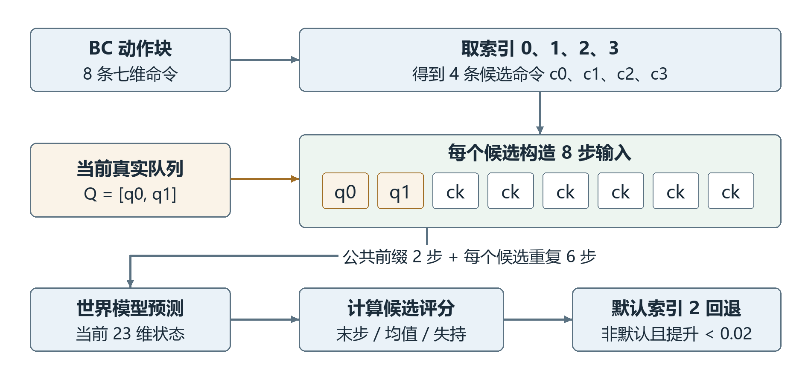
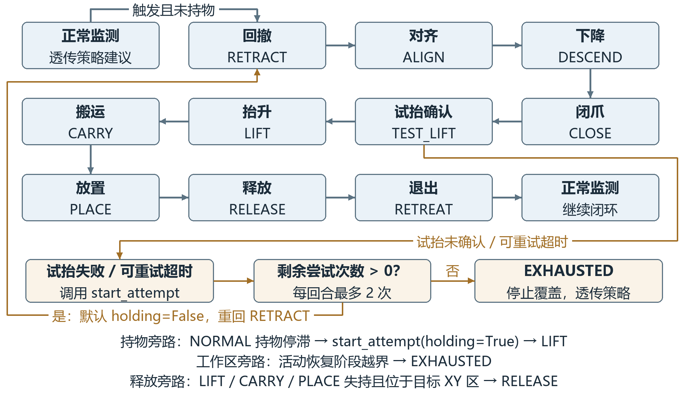
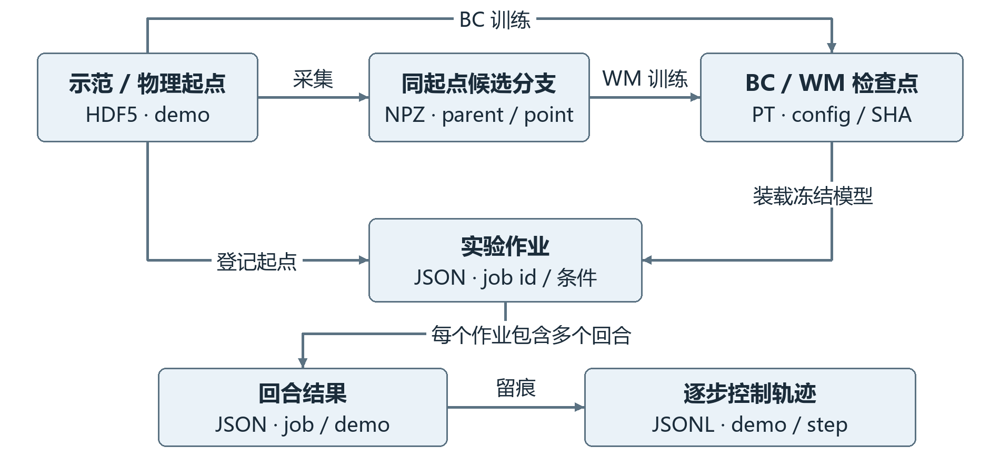
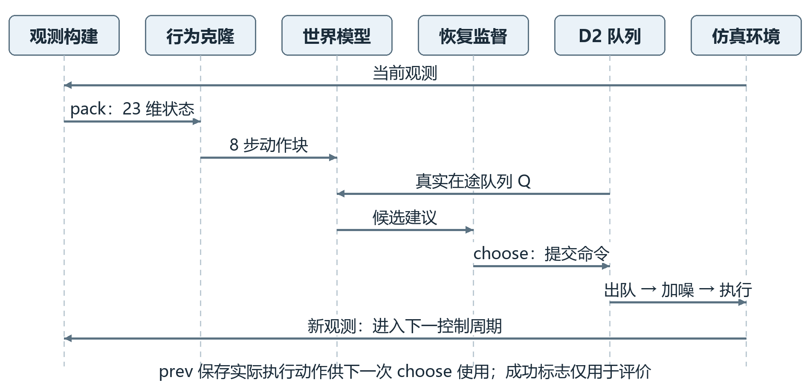

# 基于世界模型的机器人抓取搬运系统设计与实现

# 第4章 系统设计

本章面向机器人罐体抓取搬运任务，设计由行为克隆（Behavior Cloning，BC）策略、世界模型、延迟动作队列和失败恢复控制组成的闭环系统。世界模型学习状态与动作后果之间的关系，预测候选动作对应的未来状态、任务进展和失持风险，为动作选择提供依据。系统基于robosuite和MuJoCo构建Panda机器人仿真环境[1-2]，采用低维状态输入完成抓取、搬运和放置。本章依次说明系统架构、功能模块、数据组织和模块接口。

## 4.1 系统架构设计

### 4.1.1 总体架构

系统分为交互展示层、模型与控制层、数据与仿真层。交互展示层提供实验启动和结果浏览入口；模型与控制层承担动作生成、未来预测、候选评价及恢复控制；数据与仿真层保存示范、模型和执行记录，并推进机器人与物体的物理状态。各层通过文件配置、内存数组和Python函数传递数据，整体结构如图4-1所示。

图4-1 世界模型抓取搬运系统总体架构

交互展示层包括命令行运行入口和本地静态结果页面。实验人员指定策略、世界模型、扰动和恢复配置后启动任务，通过结果页面查看成功数、对照图和原始证据。页面读取已生成的结果文件，控制决策在Python评估进程内完成。

模型与控制层以世界模型动作评估为核心。行为克隆策略先生成动作块，世界模型结合当前状态和真实在途命令预测不同候选的后果，候选选择器输出建议动作。恢复监督器根据观测历史判断是否接管，随后把最终命令提交给动作队列。世界模型筛选与恢复控制分别承担动作比较和异常处置，具有独立开关。

数据与仿真层采用HDF5保存示范和起点，NPZ保存同起点分支，PT保存模型检查点，JSON及JSONL保存配置和运行结果。仿真环境以20 Hz执行七维动作，并向模型与控制层返回新观测。位置单位为米，姿态采用xyzw顺序的四元数，归一化动作范围为$[-1,1]$。

### 4.1.2 离线训练与在线控制

离线阶段由示范构造状态与动作块，训练行为克隆策略；再在两步动作延迟（D2）条件下采集同起点候选分支，训练世界模型的状态预测、任务读出和组内排序。部署时固定模型权重，并复用训练阶段的标准化参数，不在任务执行中更新网络。

在线阶段每次接收观测后重新生成和评价候选，仅提交一条新命令。当前物理执行来自队列最旧项，环境推进后再次观测。该设计将有限时域预测嵌入逐步闭环，避免把整段预测动作直接当作实际执行结果。未来真实状态与奖励只在离线监督或事后评价中使用，不作为在线筛选的真值输入。

## 4.2 系统功能设计

### 4.2.1 状态构建与预处理模块

状态构建模块将仿真器观测整理为23维向量，字段如表4-1所示。相对位姿描述物体与末端之间的抓取关系，绝对位姿描述二者在世界坐标系中的位置与姿态。目标位置来自固定任务几何，不属于23维模型输入；各状态字段须保持坐标系、四元数顺序与时间对应关系一致。

表4-1 状态向量字段设计

| 索引 | 维数 | 字段 | 含义 |
|---|---|---|---|
| 0:3 | 3 | 末端位置 | 世界坐标系位置 |
| 3:7 | 4 | 末端姿态 | 世界姿态四元数xyzw |
| 7:9 | 2 | 夹爪关节位置 | 两个夹指的关节量 |
| 9:12 | 3 | 物体相对位置 | 在末端坐标系中表达 |
| 12:16 | 4 | 物体相对姿态 | 相对末端的四元数 |
| 16:19 | 3 | 物体位置 | 世界坐标系位置 |
| 19:23 | 4 | 物体姿态 | 世界姿态四元数xyzw |

系统保留legacy和canonical两种观测语义。legacy兼容旧数据及冻结模型；canonical从同一帧绝对位姿重算相对字段，避免缓存顺序导致相对与绝对观测错位。设末端、物体世界位姿为$(p_e,q_e)$和$(p_o,q_o)$，则：

$$
p_{rel}=R(q_e)^\top(p_o-p_e),\qquad q_{rel}=q_e^{-1}\otimes q_o.
$$

其中R为四元数对应的旋转矩阵，⊗为四元数乘法。canonical检查输入维度、有限值和两个绝对四元数的有效范数，并规范相对四元数符号；legacy在线路径保留历史拼接行为。本文将联合学习状态预测、任务读出与排序的完整世界模型记为Full；当前正式Full仍使用legacy，不能只因维数相同就切换到canonical。

BC从训练窗口起点、世界模型从训练锚点计算状态均值与标准差，标准差下限为0.02，并随检查点保存。开发集和在线观测复用这些统计量。新训练读取器仅允许train和dev，200段示范划分为140段训练、30段开发及30段封存测试；训练窗口不跨轨迹边界。

### 4.2.2 行为克隆动作生成模块

行为克隆模块从当前23维状态生成8步七维动作块，为世界模型提供有限候选。网络采用三个宽度为512的多层感知机（Multilayer Perceptron，MLP）隐层和5分量混合密度输出头，使用负对数似然训练。混合密度网络能够表达连续输出的多种模式[3]，用于描述示范中的多样动作。

每个高斯分量覆盖完整动作块，输出混合权重、均值和对角标准差。均值经过tanh限于$[-1,1]$，标准差经softplus后限制在[0.02,1]。部署时选择混合权重最大的分量均值，不随机采样。动作前三维为平移控制量，中间三维为旋转控制量，最后一维为夹爪控制量。

输入为时刻t的状态，监督目标为从该时刻开始的8条示范动作，即$a_t$至$a_{t+7}$。训练采用Adam，学习率为0.0003，批量为256，共更新15,000次。新入口保存best.pt与final.pt，冻结BC基线使用预先登记的policy_15000.pt，不依据闭环结果重新选点；其权重不通过世界模型更新。

### 4.2.3 世界模型预测与学习模块

世界模型以状态和动作序列为条件，预测动作造成的短期物理变化，采用学习环境动态为控制提供信息的思路[4]。网络以门控循环单元（Gated Recurrent Unit，GRU）为核心，输入状态为23维、动作为7维，预测时域为8步，隐藏状态宽度为128。

设模型均值、尺度为μ、s，标准化初始状态为$z_0=(x_0-\mu)/s$，隐藏状态为$h_j$。初始隐藏状态由标准化初始状态经过线性层和tanh得到，随后按动作逐步递推：

$$
h_{j+1}=\operatorname{GRUCell}([z_j,u_j],h_j),\qquad z_{j+1}=z_j+0.1f_\Delta(h_{j+1}).
$$

GRU输入维数为23+7，残差网络$f_\Delta$采用128→128→23结构。系数0.1用于缩放状态增量，不代表控制周期。模型保留标准化状态参与下一步递推，仅在返回预测状态时按s与μ反标准化，全过程不注入未来真实状态。

图4-2 世界模型的离线学习与在线读出

任务读出头采用23→128→2结构，分别输出进展与失持的未归一化分数（logits）。正式Full使用future_only配置，读出头输入为标准化预测状态z，不直接拼接隐藏状态；隐藏状态仍参与动态预测。网络总可训练参数为87,321。模型未对预测姿态施加刚体投影，未来状态可能偏离严格几何关系，输入端的canonical处理不能自动约束预测结果。

训练数据按同一物理锚点组织多个动作分支。采集时先重放真实执行历史恢复锚点及控制器状态，再保留相同在途队列展开四个候选。正式数据包含160组训练分支和64组开发分支，每组4个候选、8步未来，父轨迹在训练与开发之间隔离。各候选前两步应具有相同物理结果，用于核对公共延迟前缀。

进展标签在成功时取1，否则取阶段奖励最大值，属于连续软标签。初始抓取标记取决于锚点抓取阶段奖励是否大于0.3；仅当该标记为真、后续抓取奖励低于0.3且未成功时，失持标签取1，否则取0。该定义不同于恢复器的观测抓持判据。损失包括归一化状态误差、两类标签交叉熵与组内排序：

$$
\mathcal L=\mathcal L_{pred}+\mathcal L_p+0.5\mathcal L_r+0.2\mathcal L_{rank}.
$$

其中$\mathcal L_{pred}$为预测状态与真实状态之差除以尺度s后的平方均值，平均范围包括批次、候选、未来步和状态维度。$\mathcal L_p$和$\mathcal L_r$为带logits的二元交叉熵。排序项仅对同组i<j且真实评分绝对差大于0.025的候选对，采用温度为0.1的成对逻辑损失并取均值；无有效配对时取零。

正式Full采用Adam优化，学习率为0.0003，批量为16组（64条候选序列），共更新3,000次，梯度范数上限为10；每250步验证，按开发集平均后悔值最小选择检查点，并列时保留较早检查点。后悔值为组内最优真实评分与模型所选候选真实评分之差。固定模型种子为17、23和41。

系统保留Plain（不含排序损失）、DirectScore（直接评分）及prediction_only（仅状态预测）作为对照。prediction_only按开发集状态误差选择检查点，部署时使用物理代价，绕过未训练任务头。正式恢复评估仅装载冻结Full，与通用对照入口分别管理。

表4-2 策略与世界模型主要参数

| 项目 | 行为克隆策略 | 正式Full世界模型 |
|---|---|---|
| 状态输入 | 23维 | 23维 |
| 动作时域 | 输出8步 | 预测8步 |
| 主体结构 | 三层512宽度MLP | 128宽度GRUCell |
| 输出 | 5分量动作块分布 | 未来状态及两类读出 |
| 部署方式 | 确定性选分量 | 固定权重候选评价 |
| 训练目标 | 动作块负对数似然 | 状态 标签 排序联合损失 |

### 4.2.4 候选动作评估与延迟执行模块

候选评估模块从BC动作块取索引0、1、2、3的四条命令。对每条候选命令$c_k$，模型输入序列由当前真实队列$Q_t=[q_t^0,q_t^1]$及重复候选组成：

$$
U_k=[q_t^0,q_t^1,c_k,c_k,c_k,c_k,c_k,c_k].
$$

前两步是已经提交且不能被本轮候选替换的动作，后六步反映候选持续执行的短时假设。该序列用于比较候选，在线实际只提交一条命令，下一周期重新预测。模型不预先知道之后的执行噪声，也不把预测轨迹当作真实轨迹保存。

图4-3 含真实队列前缀的候选动作评价

预测logits经sigmoid得到进展$p_j$和失持读出$r_j$，候选分数定义为：

$$
S_k=p_{k,H}+\frac{0.5}{H}\sum_{j=1}^{H}p_{k,j}-0.5\max_j r_{k,j}.
$$

评分覆盖全部8步，包含公共前缀，同时考虑末步进展、平均进展与峰值失持。先取最高分候选；若其不是默认索引2，且相对索引2的提升小于0.02，则回退到索引2。关闭世界模型时也使用索引2，保持相同BC及延迟补偿基线。读出是排序信号，不等同于经过校准的成功概率。

D2执行采用先入先出（First In, First Out，FIFO）队列，初始为两条零动作。每步先将最终提交命令$u_t$加入尾部，再取出队首命令；记加噪前的出队命令为$a_t$，则：

$$
a_t=Q_t[0],\qquad Q_{t+1}=[Q_t[1],u_t].
$$

因此$u_t$在两个周期之后执行。出队动作的前三维按配置加入标准差为0或0.05的高斯噪声，再将动作限幅到$[-1,1]$并送入环境。在20 Hz下，两周期名义延迟为0.10 s；噪声以归一化动作量计，不表示位置测量误差。

### 4.2.5 失败恢复监督模块

恢复监督器位于候选建议与队列提交之间，接收当前状态、建议动作、上一次实际执行动作及固定任务几何，不接收世界模型评分或环境成功标志。正常时透传建议，依据失持、停滞或时间压力触发恢复。时间压力指剩余步数小于按距离与阶段驻留估算的所需步数，并受物体静置资格或稳定持物条件约束。

处于NORMAL且回合累计控制步数达到80时，未持物、非主动释放、物体可达且未入目标区，可在65步无足够进展或达到第160步时触发恢复；时间压力下，距物体大于0.12 m，且25帧内距离改善小于0.008 m、抬升小于0.02 m时可提前触发。近物体或曾持物时另采用40帧、0.005 m进展阈值判断停滞；持物停滞可直接进入LIFT。

可观测抓持要求夹口宽度严格处于0.025至0.067 m之间、末端与物体距离小于0.09 m、最近五帧相对位置与当前值之差均小于0.012 m，且物体抬升超过参考高度0.02 m，并结合已执行闭爪命令或抓持锁存状态。相对位置在世界坐标系中计算，参考高度通常为回合初始物体高度，试抬时改用进入CLOSE时的物体高度。曾确认抓持后连续五帧不满足判据，且不属于主动释放时，才判为失持。

恢复流程包括回撤、对齐、下降、闭爪、试抬确认、抬升、搬运、放置、释放和退出。各阶段按需组合位姿、抓持、驻留及超时条件；CLOSE等待18步，TEST_LIFT经至少7步且确认抓持后进入LIFT，35步仍未确认则请求重试；RELEASE等待16步。图4-4给出主流程及特殊转移。

图4-4 抓取失败后的有界恢复流程

单回合最多发起两次恢复尝试，第二次尝试可继续完成；再次请求重试时才进入EXHAUSTED。活动恢复中物体越界也直接进入该状态，随后停止覆盖并透传策略建议。恢复器检查固定容器与夹爪的局部几何余量，未保证机械臂全链条避碰。队列预算扩展仍为未采用候选，本章以冻结v5为恢复实现。

### 4.2.6 结果记录与展示模块

记录模块逐步保存状态、BC动作块、候选评分、恢复诊断、队列与实际动作。基准在首次成功或达到400步时结束。成功要求罐体模型原点位于目标子区，高度介于箱底与其上方0.1 m之间，且末端与罐体间距离超过约0.0424 m，由评估器读取。成功后另执行20步张爪诊断，保留在途队列与噪声流；20步均满足成功且后10步最大速度小于0.02 m/s时记为稳定，不增加基准步数或独立起点数。

展示模块读取完成的结果与统计文件，提供条件对照、轨迹证据和失败案例入口。主确认轨迹保存scores与动作链，未保存世界模型全部预测状态；如需分析预测序列，应使用具有该字段的通用评估入口或另行登记记录方案。页面展示不参与实时控制。

## 4.3 数据结构与存储设计

### 4.3.1 数据实体及关联

系统围绕示范轨迹、候选分支、模型检查点、实验作业、回合结果和控制记录组织数据。示范轨迹以demo标识；分支保留parent及锚点，连接其来源轨迹；作业指定模型、起点和控制配置；回合以作业和demo定位；逐步记录由demo与step定位。关系如图4-5所示。

图4-5 研究数据实体及逻辑关联

这些关系由文件元数据和程序校验维护。本项目以HDF5分组保存示范的观测与动作，便于按轨迹读取和划分，满足离线示范学习的数据组织需求[5]；分支训练使用NPZ按候选组装载，模型权重及配置共同写入PT。JSON保存配置与汇总，JSONL按行保存控制轨迹。

表4-3 数据实体与存储方式

| 实体 | 存储形式 | 主要内容 | 关联标识 |
|---|---|---|---|
| 示范与起点 | HDF5 | 观测 动作 物理状态 XML | demo |
| 候选分支 | NPZ | 同起点候选及未来标签 | parent point |
| 模型检查点 | PT | 网络参数 配置 标准化量 | 路径与SHA-256摘要 |
| 实验作业 | JSON | 方法 起点 延迟 噪声 | id |
| 回合结果 | JSON | 成功 步数 恢复与计时 | job demo |
| 控制轨迹 | JSONL | 状态 动作 队列 诊断 | demo step |

### 4.3.2 候选分支与检查点结构

分支数据必须保留同起点的候选组，训练时先抽取组，再把组内候选展开为批量序列。设组数为N，候选数为K=4，时域H=8，主要数组设计如表4-4所示。将同一候选组拆散后随机划分训练与开发会引入共享起点信息，因此数据划分以parent为单位。

表4-4 世界模型分支数据字段

| 字段 | 形状或类型 | 含义 |
|---|---|---|
| x | N×23 | 锚点当前状态 |
| a | N×K×H×7 | 真实出队执行动作序列 |
| queue | N×2×7 | 锚点处在途命令 |
| commands | N×K×H×7 | 每个候选的重复提交序列 |
| y | N×K×H×23 | 分支未来物理状态 |
| labels | N×K×H×2 | 进展与失持监督 |
| parent、point | N个字符串、N个整数 | 父轨迹及已执行前缀步数 |
| observation_semantics | 可选标量字符串 | 新文件声明观测语义 |

正式分支文件不含observation_semantics，加载时按legacy解释；新canonical分支须显式声明语义并核对几何一致性。point表示锚点之前已执行的控制步数，不是原示范帧索引。parent用于检查父轨迹隔离，缺失时无法完成同等检查，不应直接用于正式比较。

检查点的state_dict保存网络权重与标准化缓冲量。世界模型config包含dim、horizon、width、method及seed；BC配置包含dim、horizon、width及mixtures，未必含method。新BC配置记录architecture；历史检查点缺省为MLP，观测语义缺省为legacy。加载时核对任务契约，正式Full另要求future_only为真。

### 4.3.3 作业与执行记录结构

作业由id、method、seed、controller、semantics、noise、demos、steps和delay等字段组成。正式恢复作业限定method为bc或full，controller为none、v5或queue_budget，steps为400、delay为2。Full使用三个已登记的固定模型种子，起点列表必须非空且无重复。

result.json包含作业副本、运行状态及回合records。每个回合记录成功与终止步数、干预步数、尝试次数、恢复事件及计时。trace.jsonl按表4-5记录完整控制链，使候选建议、恢复覆盖和延迟执行可以逐项区分。

表4-5 逐步控制记录字段

| 字段组 | 主要字段 | 记录目的 |
|---|---|---|
| 身份 | demo、step | 定位回合与控制周期 |
| 决策输入 | state_before、base_chunk | 保存观测和BC建议 |
| 候选评估 | selected、scores、proposal | 还原候选比较与回退 |
| 恢复输出 | recovery、submitted_action | 定位动作覆盖与转换 |
| 延迟执行 | queue_before、executed_action | 核对FIFO与实际动作 |
| 执行后 | state_after、success_after | 检查状态连续性与终止 |
| 计算耗时 | compute_ms | 观察模型与控制计算量 |

加噪前的出队命令另存executed_action_before_noise。活动恢复诊断中，mode对应本步生成动作的阶段，next_mode为转移后的状态。compute_ms包含观测打包、BC、可选世界模型和恢复计算，不含物理推进与文件写入。输出目录拒绝复用，result.json.status区分单作业的running、complete和failed；批次通过完成回执与来源一致性检查后进入统计。

## 4.4 模块接口与协同流程设计

### 4.4.1 模块接口

系统采用同一Python进程内的函数调用，传递NumPy数组或PyTorch张量。主要接口如表4-6所示，其中B为批量大小，K=4；输入单位和语义沿用前述状态与动作约定。

表4-6 主要模块接口

| 接口 | 输入 | 输出 | 约束 |
|---|---|---|---|
| pack_observation | 原始观测与语义 | 23维状态 | 语义与模型匹配 |
| ChunkPolicy.best | B×23状态 | B×8×7动作块 | 复用训练标准化量 |
| WorldModel.forward | B×23状态与B×8×7动作 | B×8×23状态与B×8×2 logits | 不返回标签概率 |
| pending_sequences | 2×7队列与候选 | K×8×7序列 | 使用真实在途命令 |
| propose | 模型 状态 BC块 队列 | 建议 索引 评分或None | 0.02回退；无模型评分为空 |
| RecoveryController.choose | 状态 建议 上次实际动作 | 提交动作与诊断 | 不接收评分或成功真值 |

启动时核对状态维数、动作时域和控制比例。操作空间位姿控制器（OSC_POSE）采用世界参考系增量控制，平移每轴输出上限为0.05 m、旋转每轴上限为0.5 rad，接口原理参见官方文档[6]，具体数值由环境配置确定。归一化命令与控制比例的乘积不等于接触状态下必然实现的末端位移。

### 4.4.2 闭环调用时序

闭环先构建状态并调用BC，再依据真实队列评价候选；恢复监督器可覆盖建议，最终提交动作才进入队列。出队后加噪并限幅，环境执行并返回新观测。调用顺序如图4-6所示。

图4-6 单个控制周期的调用时序

恢复器中的previous_action必须是上一周期已经实际执行、经过加噪和限幅的动作，而不是上一条新提交命令。对预算扩展，评估器在choose前提供当前队列副本。环境成功检查位于执行之后，仅决定记录与回合终止；其结果不会进入恢复器触发条件。

### 4.4.3 配置与异常处理

启动时检查模型配置、观测语义、起点存在性及控制预算，运行时构造两项FIFO并在Full候选展开时核对队列形状。正式Full仅接受legacy与已登记模型种子；控制器延迟和上限须与实际执行一致。模型方法不支持所选读出时拒绝启动，防止使用未训练标签头产生评分。

运行异常时保留已有轨迹并尝试写入failed状态，结束时释放仿真环境。结果文件分次写入；发生记录故障时保留原尝试，在新目录使用相同冻结输入重新执行，并比较重复前缀。来源哈希与作业快照用于检测文件变化，重复执行不增加独立样本数。

## 4.5 本章小结

本章完成基于世界模型的机器人抓取搬运系统详细设计。系统以行为克隆提供候选，通过动作条件世界模型预测未来状态并评价动作后果，结合真实D2队列实现逐步闭环，由独立恢复监督器处理失持和停滞。数据设计明确示范、分支、检查点和运行记录的关联，模块接口限定输入语义及调用顺序，为后续系统实现与实验测试提供依据。当前设计面向低维特权状态仿真，世界模型与恢复模块的性能作用以各自的同批对照结果为依据。

# 参考文献

[1] ZHU Y, WONG J, MANDLEKAR A, et al. robosuite: A Modular Simulation Framework and Benchmark for Robot Learning[EB/OL]. arXiv:2009.12293v1, 2020[2026-10-22]. https://arxiv.org/abs/2009.12293v1.

[2] TODOROV E, EREZ T, TASSA Y. MuJoCo: A physics engine for model-based control[C]//2012 IEEE/RSJ International Conference on Intelligent Robots and Systems. IEEE, 2012. DOI: 10.1109/IROS.2012.6386109.

[3] BISHOP C M. Mixture Density Networks[R]. Birmingham: Aston University, 1994. NCRG/94/004.

[4] HA D, SCHMIDHUBER J. World Models[EB/OL]. arXiv:1803.10122, 2018[2026-10-22]. https://arxiv.org/abs/1803.10122.

[5] MANDLEKAR A, XU D, WONG J, et al. What Matters in Learning from Offline Human Demonstrations for Robot Manipulation[C]//Proceedings of the 5th Conference on Robot Learning. PMLR, 2022, 164: 1678-1690.

[6] robosuite. Controllers[EB/OL]. [2026-10-22]. https://robosuite.ai/docs/modules/controllers.html.
